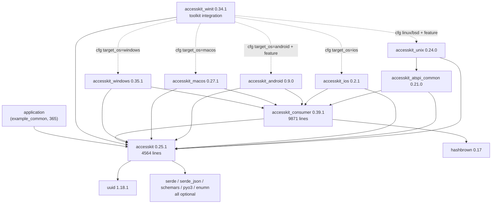

# 23 — The core boundary in the AccessKit workspace

Consumed by: `docs/30-port-design.md`, which turns the module proposal in section 7 into
a file plan, and `docs/40-plan.md`, which schedules the milestones.

## 0. Scope and method

This document answers one question: where is the line between the platform-neutral part
of AccessKit and the platform-specific part, and where must the Zig port put its own
line.

All evidence comes from a read-only checkout:

| Field | Value |
|---|---|
| Path | `/tmp/scratch/accesskit` |
| Commit | `466e24e252103f4d82bd6fbab98141b551e46e0c` |
| Core crate version | `accesskit` 0.25.1 (`accesskit/Cargo.toml:3`) |
| Consumer crate version | `accesskit_consumer` 0.39.1 (`accesskit_consumer/Cargo.toml:3`) |
| Edition | 2024 (`Cargo.toml:24`) |
| Minimum Rust | 1.87 (`Cargo.toml:27`) |

Two commands produced every count in this document:

```
$ git -C /tmp/scratch/accesskit rev-parse HEAD
466e24e252103f4d82bd6fbab98141b551e46e0c

$ wc -l accesskit/src/*.rs accesskit_consumer/src/*.rs example_common/src/*.rs
   866 accesskit/src/geometry.rs
  3698 accesskit/src/lib.rs
   421 accesskit_consumer/src/filters.rs
  1060 accesskit_consumer/src/iterators.rs
   210 accesskit_consumer/src/lib.rs
  2120 accesskit_consumer/src/node.rs
  2836 accesskit_consumer/src/text.rs
  3224 accesskit_consumer/src/tree.rs
    24 example_common/src/key.rs
   265 example_common/src/lib.rs
    76 example_common/src/render.rs
 14800 total
```

Section 6 also counts macro-generated code. The counts come from a script that reads
the file and pairs each `macro_rules!` invocation with the number of `(...)` entries in
its body. That script is not part of this repository and is not needed to check the
counts again. A reviewer can check them with
`grep -nE '^[a-z0-9_]+! *\{$' accesskit/src/lib.rs` followed by a read of each block.

Nothing in this document was written from memory. Every line reference was read.

---

## 1. The upstream crate split

The workspace has ten members (`Cargo.toml:3-14`). Three are libraries that a port must
reproduce. Six are platform adapters. One is a toolkit integration.

Command:

```
$ for d in accesskit accesskit_consumer example_common adapters/android \
    adapters/atspi-common adapters/ios adapters/macos adapters/unix \
    adapters/windows adapters/winit; do
    printf "%-24s " $d; find $d -name '*.rs' -exec cat {} + | wc -l
  done
accesskit                4564
accesskit_consumer       9871
example_common            365
adapters/android         2978
adapters/atspi-common    4417
adapters/ios             2560
adapters/macos           2605
adapters/unix            2760
adapters/windows         4793
adapters/winit           1032
```

| Crate | Directory | Rust lines | Version | What it owns | What it must not know about |
|---|---|---|---|---|---|
| `accesskit` | `accesskit/` | 4564 | 0.25.1 | The wire vocabulary. `Role` (`lib.rs:62`), `Action` (`lib.rs:289`), the 13 property enums (`lib.rs:417-700`), `NodeId` and `TreeId` (`lib.rs:715`, `lib.rs:745`), the `Node` property bag (`lib.rs:1107`), `TreeInfo` and `TreeUpdate` (`lib.rs:3169`, `lib.rs:3208`), `ActionRequest` (`lib.rs:3328`), the 5 geometry types (`geometry.rs:22`, `212`, `337`, `571`, `717`), and the 3 handler traits (`lib.rs:3336`, `3362`, `3376`). | Any platform. Any socket, handle, thread, clock, allocator, or event loop. |
| `accesskit_consumer` | `accesskit_consumer/` | 9871 | 0.39.1 | The tree that a consumer reads. `Tree` and `TreeState` (`tree.rs:586`, `tree.rs:67`), `ChangeHandler` (`tree.rs:578`), `FullNodeId` and `NodeRef` (`node.rs:30`, `node.rs:78`), the filtering rules (`filters.rs:11`, `54`, `94`), the sibling and child iterators (`iterators.rs:22`, `79`, `170`, `341`, `409`, `477`, `537`), and the text position and range algebra (`text.rs:161`, `613`, `897`). | Any platform. It never names one. |
| `example_common` | `example_common/` | 365 | 0.0.1, `publish = false` (`example_common/Cargo.toml:8`) | A demo application. A four-button window, key handling (`key.rs`), and a software renderer (`render.rs`). | The adapters. It is a dev-dependency only. |
| `accesskit_android` | `adapters/android/` | 2978 | 0.9.0 | JNI glue and the Android `AccessibilityNodeInfo` surface. | Anything but JNI and Android. |
| `accesskit_atspi_common` | `adapters/atspi-common/` | 4417 | 0.21.0 | The AT-SPI protocol layer: interface sets, states, cache events, and the `AdapterCallback` trait (`callback.rs:11`). | A display server. It is a library over `atspi-common` and `zvariant`. |
| `accesskit_ios` | `adapters/ios/` | 2560 | 0.2.1 | `UIAccessibility` objects and `UIView` subclassing. | UIKit internals. |
| `accesskit_macos` | `adapters/macos/` | 2605 | 0.27.1 | `NSAccessibility` objects and `NSView` subclassing. | AppKit internals. |
| `accesskit_unix` | `adapters/unix/` | 2760 | 0.24.0 | The D-Bus client, the `atspi` proxy interfaces, and the async executor choice. | A specific toolkit. It takes an `ActivationHandler`, not a window. |
| `accesskit_windows` | `adapters/windows/` | 4793 | 0.35.1 | The COM and UI Automation objects, window subclassing, and `WM_GETOBJECT`. | Win32 internals outside the ten feature flags in `adapters/windows/Cargo.toml:28-39`. |
| `accesskit_winit` | `adapters/winit/` | 1032 | 0.34.1 | A toolkit integration, not a platform adapter. See section 5. | The platform. It holds one `platform_impl::Adapter` (`winit/src/lib.rs:128`). |

Three numbers matter for planning. The workspace holds 35945 Rust lines. The
platform-neutral part is 14435 of them, which is 4564 for `accesskit` plus 9871 for
`accesskit_consumer`. The five platform adapters hold 20113. The toolkit bridge holds
1032. The demo application holds 365. A port that stops at the neutral line delivers
40 percent of the upstream code.

The `adapters/winit` figure of 1032 includes two examples. The library itself is 631
lines:

```
$ wc -l adapters/winit/src/lib.rs adapters/winit/src/platform_impl/*.rs | tail -1
  631 total
```

---

## 2. What the core crate knows

**Claim.** `accesskit/src/` names no platform. It has no target conditional
compilation, no platform crate import, and no platform type.

### 2.1 Every import in the core crate

```
$ grep -nE '^use |^pub use |^extern crate ' accesskit/src/lib.rs accesskit/src/geometry.rs
accesskit/src/lib.rs:13:extern crate alloc;
accesskit/src/lib.rs:16:use alloc::borrow::Cow;
accesskit/src/lib.rs:17:use alloc::{borrow::ToOwned, boxed::Box, string::String, vec::Vec};
accesskit/src/lib.rs:18:use core::fmt;
accesskit/src/lib.rs:20:use pyo3::pyclass;
accesskit/src/lib.rs:22:use schemars::{JsonSchema, Schema, SchemaGenerator, json_schema};
accesskit/src/lib.rs:24:use serde::{
accesskit/src/lib.rs:30:use serde_json::{Map as SchemaMap, Value as SchemaValue};
accesskit/src/lib.rs:32:pub use uuid::Uuid;
accesskit/src/lib.rs:35:pub use geometry::{Affine, Point, Rect, Size, Vec2};
accesskit/src/geometry.rs:12:use core::{
exit=0
```

Reading the list:

- Lines 13 to 18 are the Rust standard library and `alloc`.
- Lines 20, 22, 24, 30 sit behind `#[cfg(feature = ...)]` gates (`lib.rs:19`, `21`, `23`, `29`).
  They are code generators, not runtime dependencies.
- Line 32 is the one unconditional foreign import. See 2.5.
- Line 35 re-exports the local `geometry` module (`lib.rs:34`).

### 2.2 No target conditional

```
$ grep -rnE 'target_os|target_family|target_env|target_arch|cfg\(unix|cfg\(windows|cfg\(target' accesskit/src/
exit=1
```

`exit=1` is `grep`'s no-match status. There is not one match in the crate. Every `#[cfg]`
and `#[cfg_attr]` in `accesskit/src/lib.rs` tests a Cargo feature name. For example
`lib.rs:11` reads `#![cfg_attr(not(any(feature = "pyo3", feature = "schemars")), no_std)]`.

### 2.3 No platform word, except one comment

```
$ grep -rnw -i -E 'windows|macos|linux|android|ios|unix|atspi|objc|jni|cocoa|apple|x11|wayland|winit|dbus' accesskit/src/
accesskit/src/lib.rs:2415:    /// (as in Windows Notepad).
exit=0
```

One match. Line 2415 is a doc comment that names Notepad as the reason for a `TabSize`
default. It is prose, not code. Compare with the adapters, where the same words are
identifiers: `adapters/windows/src/lib.rs:19` re-exports `HWND`, `LPARAM`, `LRESULT`, and
`WPARAM` from `windows::Win32::Foundation`.

The word `Role` at `lib.rs:62` and later lines matched a naive grep because
`Role`, `ComboBox`, `Complementary`, `RightToLeft`, and `AutoComplete` contain
case-insensitive fragments such as `ole` and `ios`. The word-boundary grep above
removes those false hits.

### 2.4 What the core crate is forbidden to reference

Upstream enforces this by review, not by tooling. A port must enforce it by a test.
The forbidden list, derived from the imports that do appear in the adapters:

| Forbidden in the core | Why | Where an adapter needs it |
|---|---|---|
| A target predicate such as `target_os` | A single binary then has two trees | `adapters/winit/src/platform_impl/mod.rs:9-55` |
| A platform crate: `windows`, `objc2`, `jni`, `zbus`, `atspi`, `winit` | The core stops being portable | `adapters/windows/Cargo.toml:27`, `adapters/macos/Cargo.toml:21`, `adapters/android/Cargo.toml:21`, `adapters/unix/Cargo.toml:25` |
| A platform type: `HWND`, `NSView`, `UIView`, `JObject`, a D-Bus proxy | Same | `adapters/windows/src/lib.rs:19`, `adapters/macos/src/node.rs:16` |
| A toolkit type: `Window`, `ActiveEventLoop`, `EventLoopProxy` | A core that knows a toolkit is not portable | `adapters/winit/src/lib.rs:53-57` |
| A thread, a clock, an event loop, or a global allocator | Breaks the house rule on `io` as a parameter | not present |
| A font, a glyph, or a text-shaping library | Geometry and text stay separate | see `docs/19-geometry-and-text.md` |

### 2.5 The one foreign type

`TreeId` is a newtype over `uuid::Uuid` (`lib.rs:745`), re-exported at `lib.rs:32`. The
manifest pins `uuid = { version = "1", default-features = false }`
(`accesskit/Cargo.toml:23`), and `Cargo.lock:2231-2233` resolves it to 1.18.1.

The whole surface the core needs from `Uuid` is:

| Use | Line |
|---|---|
| `pub use uuid::Uuid` | `lib.rs:32` |
| `pub struct TreeId(pub Uuid)` | `lib.rs:745` |
| `pub const ROOT: Self = Self(Uuid::nil())` | `lib.rs:749` |
| Serde derive over `Uuid`, behind the `serde` feature | `lib.rs:757`, `accesskit/Cargo.toml:28` |

So the port needs 16 opaque bytes, an equality test, and a nil constant. It does not
need version 4 generation, formatting, or parsing. Section 7 proposes a 16-byte
`TreeId` with a `root` constant and no `Uuid` name at all.

---

## 3. What `accesskit_consumer` owns

The consumer crate is the largest part of the platform-neutral system. It is 9871 lines
across six files. Its own README states the scope: "This library is used by code that
consumes AccessKit accessibility trees, such as platform adapters. It does not need to
be used directly by applications integrating AccessKit."
(`accesskit_consumer/README.md:3`).

### 3.1 The complete responsibility list

| # | Responsibility | Evidence | Public surface |
|---|---|---|---|
| 1 | Namespace every node id by its tree | `tree.rs:15` `TreeIndex`, `tree.rs:18` `TreeIndexMap`, `node.rs:30` `FullNodeId`, `node.rs:33` `FullNodeId::new` | `FullNodeId` (`lib.rs:14`) |
| 2 | Hold the tree in memory | `tree.rs:67` `TreeState` | `TreeState` (`lib.rs:11`) |
| 3 | Apply one `TreeUpdate` to that state | `tree.rs:124` `TreeState::update` | private |
| 4 | Detect what changed and report it | `tree.rs:79` `InternalChanges`, `tree.rs:640` `Tree::process_changes` | private |
| 5 | Define the change callback | `tree.rs:578` `ChangeHandler` with `node_added`, `node_updated`, `focus_moved`, `node_removed` | `TreeChangeHandler` (`lib.rs:11`) |
| 6 | Keep two tree states so a change can name the old and the new node | `tree.rs:586-589` `Tree { state, next_state }` | `Tree` (`lib.rs:11`) |
| 7 | Validate the global invariants | `tree.rs:86` `validate_global`, `tree.rs:592` `Tree::new` | private, panics |
| 8 | Resolve focus through graft chains | `tree.rs:101` `compute_effective_focus`, `tree.rs:518` `subtree_root`, `tree.rs:545` `active_dialog` | `TreeState` queries |
| 9 | Map between a local id and a `TreeId` | `tree.rs:500` `node_by_tree_local_id`, `tree.rs:567` `locate_node`, `node.rs:401` `locate` | `TreeState`, `NodeRef` |
| 10 | Query the hierarchy | `node.rs:115` `is_root`, `126` `parent_id`, `168` `child_ids`, `196` `following_sibling_ids`, `217` `preceding_sibling_ids`, `238` `deepest_first_child`, `257` `deepest_last_child`, `276` `is_descendant_of` | `NodeRef` |
| 11 | Compute geometry in tree space | `node.rs:291` `direct_transform`, `299` `transform`, `309` `relative_transform`, `322` `raw_bounds`, `332` `bounding_box`, `338` `bounding_box_in_coordinate_space` | `NodeRef` |
| 12 | Hit test a point against the tree | `node.rs:344` `hit_test`, `389` `node_at_point` | `NodeRef::node_at_point` |
| 13 | Read inherited and composed properties | `node.rs:534` `fetch_inherited_property`, `548` `fetch_inherited_flag`, `562` `is_text_input`, `606` `is_modal`, `657` `supports_toggle`, `661` `supports_expand_collapse`, `687` `supports_action` | 114 `NodeRef` methods (`node.rs`) |
| 14 | Compute an accessible label and value | `node.rs:719` `labelled_by`, `744` `label_comes_from_value`, `748` `label`, `775` `write_label`, `840` `value`, `845` `write_value`, `1076` `descendant_label_filter` | `NodeRef` |
| 15 | Decide which nodes reach the platform | `filters.rs:11` `FilterResult`, `17` `common_filter_base`, `43` `is_first_sibling_in_parent_bbox`, `54` `common_filter`, `94` `common_filter_with_root_exception` | `FilterResult`, `common_filter`, `common_filter_with_root_exception` (`lib.rs:17`) |
| 16 | Iterate the filtered tree | `iterators.rs:22` `ChildIds`, `79` `FollowingSiblings`, `170` `PrecedingSiblings`, `341` `FollowingFilteredSiblings`, `409` `PrecedingFilteredSiblings`, `477` `FilteredChildren`, `537` `LabelledBy`, `255` `next_filtered_sibling`, `296` `previous_filtered_sibling` | iterators |
| 17 | Model a text position inside a run | `text.rs:16` `InnerPosition`, `161` `Position`, and 30 movement methods from `text.rs:294` to `text.rs:570` | `TextPosition` (`lib.rs:23`) |
| 18 | Convert between index units | `text.rs:241` `to_global_usv_index`, `259` `to_global_utf16_index`, `281` `to_line_index`, `1571` `text_position_from_global_usv_index`, `1610` `text_position_from_global_utf16_index` | `TextPosition` |
| 19 | Model a text range and a weak range | `text.rs:595` `RangePropertyValue`, `613` `Range`, `897` `WeakRange`, `740` `bounding_boxes`, `870` `to_text_selection` | `TextRange`, `TextRangePropertyValue`, `WeakTextRange` (`lib.rs:22-25`) |
| 20 | Resolve text hit tests | `text.rs:932` `text_node_filter`, `940` `character_index_at_point`, `1485` `text_position_at_point`, `1548` `line_range_from_index` | `NodeRef` text methods |
| 21 | Depend on a hash map | `accesskit_consumer/Cargo.toml:16` `hashbrown.workspace = true`, pinned at `Cargo.toml:30` to 0.17 | internal |

### 3.2 Why it is a separate crate

**It exists to keep the core small.** The core must build for a browser or a phone. The
consumer allocates a hash map per adapter and builds text ranges. Moving it into the
core would put 9871 lines of allocation-heavy code in a crate that currently has no
foreign dependency at all (`section 2.1`). The manifest shows the split:
`accesskit` depends on `uuid` and optional code generators only
(`accesskit/Cargo.toml:17-23`), while `accesskit_consumer` adds `hashbrown`
(`accesskit_consumer/Cargo.toml:16`).

**It has a different audience.** `ARCHITECTURE.md:39` states that a reader is "unlikely
to need to look at `accesskit_consumer` unless you're writing a platform adapter or a
testing system". An application that only produces `Node` values never links it.

**It has a different versioning story.** The two crates move independently:
`accesskit` is at 0.25.1 and `accesskit_consumer` is at 0.39.1. The consumer is the
older-numbered but the more-changed crate. Merging them would force every adapter to
rebuild for a text-range change.

**It lets the adapters share one tree.** Every adapter that keeps a tree depends on the
consumer, not on its own copy of the logic. See the edge table in section 4.

### 3.3 What breaks if the crates were merged

| Break | Evidence |
|---|---|
| The core crate stops being `no_std` with no foreign runtime | `lib.rs:11` is `no_std` only when neither `pyo3` nor `schemars` is on. `hashbrown` needs `default-features = false` plus `default-hasher` (`Cargo.toml:30`), which the core does not request. |
| Five adapters gain a hash-map dependency they do not need | `adapters/ios/Cargo.toml:20`, `adapters/macos/Cargo.toml:20`, `adapters/windows/Cargo.toml:22`, `adapters/android/Cargo.toml:15-16`, `adapters/unix/Cargo.toml:14-17` all gate a map behind a feature. |
| The C ABI cannot be generated from the core | `docs/11-accesskit-c-abi.md` owns this. The core carries a deliberate "cannot use a macro as it would break C bindings header file generation" comment at `lib.rs:359-361`, and it repeats the same pattern 23 times from `lib.rs:1170` to `1778`. The consumer has no such constraint, but it still defines two macros, `inherited_properties!` at `accesskit_consumer/src/text.rs:980` and `inherited_flags!` at `text.rs:1215`. |
| Version skew disappears and adapter releases couple | `Cargo.toml:3` vs `accesskit_consumer/Cargo.toml:3` |
| A pure-function core becomes a stateful module | `Tree` at `tree.rs:586` owns two full copies of the tree |

The port must keep the split. It is the same split `docs/20-zio-and-zig-io.md` needs:
core code takes no `io`, consumer code takes no `io`, and only the adapter takes `io`.

---

## 4. The dependency direction

Every edge below is quoted from a manifest. No edge is inferred.

### 4.1 Diagram



Solid edges are unconditional. Dotted edges are target-gated.

### 4.2 Every edge, with its manifest line

| From | To | Constraint | Manifest line |
|---|---|---|---|
| `accesskit_consumer` | `accesskit` | `version = "0.25.1", path = "../accesskit"` | `accesskit_consumer/Cargo.toml:15` |
| `accesskit_consumer` | `hashbrown` | `workspace = true`, which resolves to `version = "0.17", default-features = false, features = ["default-hasher"]` | `accesskit_consumer/Cargo.toml:16`, `Cargo.toml:30` |
| `example_common` | `accesskit` | `path = "../accesskit"`, no version | `example_common/Cargo.toml:11` |
| `example_common` | `raw-window-handle` | `0.6.2` | `example_common/Cargo.toml:12` |
| `example_common` | `softbuffer` | `0.4.8`, non-mobile target, features `x11`, `x11-dlopen`, `wayland`, `wayland-dlopen` | `example_common/Cargo.toml:14-22` |
| `example_common` | `softbuffer` | `0.4.8`, iOS target | `example_common/Cargo.toml:24-26` |
| `accesskit_android` | `accesskit` | `version = "0.25.1", path = "../../accesskit"` | `adapters/android/Cargo.toml:19` |
| `accesskit_android` | `accesskit_consumer` | `version = "0.39.1", path = "../../accesskit_consumer"` | `adapters/android/Cargo.toml:20` |
| `accesskit_android` | `jni` | `0.21.1` | `adapters/android/Cargo.toml:21` |
| `accesskit_android` | `log` | `0.4.17` | `adapters/android/Cargo.toml:22` |
| `accesskit_android` | `example_common` | dev-dependency, `path` | `adapters/android/Cargo.toml:25` |
| `accesskit_atspi_common` | `accesskit` | `version = "0.25.1"` | `adapters/atspi-common/Cargo.toml:18` |
| `accesskit_atspi_common` | `accesskit_consumer` | `version = "0.39.1"` | `adapters/atspi-common/Cargo.toml:19` |
| `accesskit_atspi_common` | `atspi-common` | `0.13`, `default-features = false` | `adapters/atspi-common/Cargo.toml:20` |
| `accesskit_atspi_common` | `phf` | `0.14.0`, features `macros` | `adapters/atspi-common/Cargo.toml:21` |
| `accesskit_atspi_common` | `serde` | `1.0` | `adapters/atspi-common/Cargo.toml:22` |
| `accesskit_atspi_common` | `zvariant` | `5.15`, `default-features = false` | `adapters/atspi-common/Cargo.toml:23` |
| `accesskit_ios` | `accesskit` | `version = "0.25.1"` | `adapters/ios/Cargo.toml:18` |
| `accesskit_ios` | `accesskit_consumer` | `version = "0.39.1"` | `adapters/ios/Cargo.toml:19` |
| `accesskit_ios` | `hashbrown` | `workspace = true` | `adapters/ios/Cargo.toml:20` |
| `accesskit_ios` | `objc2` | `0.5.1` | `adapters/ios/Cargo.toml:21` |
| `accesskit_ios` | `objc2-foundation` | `0.2.0`, eight named features | `adapters/ios/Cargo.toml:22-30` |
| `accesskit_ios` | `objc2-ui-kit` | `0.2.0`, eleven named features | `adapters/ios/Cargo.toml:31-43` |
| `accesskit_macos` | `accesskit` | `version = "0.25.1"` | `adapters/macos/Cargo.toml:18` |
| `accesskit_macos` | `accesskit_consumer` | `version = "0.39.1"` | `adapters/macos/Cargo.toml:19` |
| `accesskit_macos` | `hashbrown` | `workspace = true` | `adapters/macos/Cargo.toml:20` |
| `accesskit_macos` | `objc2` | `0.5.1` | `adapters/macos/Cargo.toml:21` |
| `accesskit_macos` | `objc2-foundation` | `0.2.0`, four named features | `adapters/macos/Cargo.toml:22-27` |
| `accesskit_macos` | `objc2-app-kit` | `0.2.0`, nine named features | `adapters/macos/Cargo.toml:28-38` |
| `accesskit_unix` | `accesskit` | `version = "0.25.1"` | `adapters/unix/Cargo.toml:20` |
| `accesskit_unix` | `accesskit_atspi_common` | `version = "0.21.0", path = "../atspi-common"` | `adapters/unix/Cargo.toml:21` |
| `accesskit_unix` | `atspi` | `0.29`, features `proxies` | `adapters/unix/Cargo.toml:22` |
| `accesskit_unix` | `futures-lite` | `2.3` | `adapters/unix/Cargo.toml:23` |
| `accesskit_unix` | `serde` | `1.0` | `adapters/unix/Cargo.toml:24` |
| `accesskit_unix` | `zbus` | `5.19`, features `async-io` | `adapters/unix/Cargo.toml:25` |
| `accesskit_unix` | `async-channel` | `2.1.1`, optional, feature `async-io` | `adapters/unix/Cargo.toml:16`, `28` |
| `accesskit_unix` | `async-executor` | `1.5.0`, optional, feature `async-io` | `adapters/unix/Cargo.toml:16`, `29` |
| `accesskit_unix` | `async-task` | `4.3.0`, optional, feature `async-io` | `adapters/unix/Cargo.toml:16`, `30` |
| `accesskit_unix` | `futures-util` | `0.3.27`, optional, feature `async-io` | `adapters/unix/Cargo.toml:16`, `31` |
| `accesskit_unix` | `tokio-stream` | `0.1.14`, optional, feature `tokio` | `adapters/unix/Cargo.toml:17`, `34` |
| `accesskit_unix` | `tokio` | `1.32.0`, optional, features `macros`, `net`, `rt`, `sync`, `time` | `adapters/unix/Cargo.toml:17`, `35-38` |
| `accesskit_windows` | `accesskit` | `version = "0.25.1"` | `adapters/windows/Cargo.toml:20` |
| `accesskit_windows` | `accesskit_consumer` | `version = "0.39.1"` | `adapters/windows/Cargo.toml:21` |
| `accesskit_windows` | `hashbrown` | `workspace = true` | `adapters/windows/Cargo.toml:22` |
| `accesskit_windows` | `static_assertions` | `1.1.0` | `adapters/windows/Cargo.toml:23` |
| `accesskit_windows` | `windows-core` | `0.62.0` | `adapters/windows/Cargo.toml:24` |
| `accesskit_windows` | `windows` | `0.62.0`, ten named features | `adapters/windows/Cargo.toml:26-39` |
| `accesskit_winit` | `accesskit` | `version = "0.25.1"` | `adapters/winit/Cargo.toml:23` |
| `accesskit_winit` | `winit` | `0.30.5`, `default-features = false` | `adapters/winit/Cargo.toml:24` |
| `accesskit_winit` | `rwh_05` | `raw-window-handle` `0.5`, optional | `adapters/winit/Cargo.toml:25` |
| `accesskit_winit` | `rwh_06` | `raw-window-handle` `0.6.2`, optional | `adapters/winit/Cargo.toml:26` |
| `accesskit_winit` | `accesskit_windows` | `version = "0.35.1"`, `cfg(target_os = "windows")` | `adapters/winit/Cargo.toml:28-29` |
| `accesskit_winit` | `accesskit_macos` | `version = "0.27.1"`, `cfg(target_os = "macos")` | `adapters/winit/Cargo.toml:31-32` |
| `accesskit_winit` | `accesskit_unix` | `version = "0.24.0"`, optional, `cfg` on linux and the four BSD targets | `adapters/winit/Cargo.toml:34-35` |
| `accesskit_winit` | `accesskit_android` | `version = "0.9.0"`, optional, feature `embedded-dex`, `cfg(target_os = "android")` | `adapters/winit/Cargo.toml:37-38` |
| `accesskit_winit` | `accesskit_ios` | `version = "0.2.1"`, `cfg(target_os = "ios")` | `adapters/winit/Cargo.toml:40-41` |
| `accesskit_winit` | `example_common` | dev-dependency, `path` | `adapters/winit/Cargo.toml:44` |

### 4.3 Three facts from the edge table

**The graph is a fan-out from two roots.** Every adapter depends on `accesskit`, and
every adapter except `accesskit_unix` also depends on `accesskit_consumer`. There is no
edge between two adapters except `accesskit_unix` to `accesskit_atspi_common`. The
architecture agrees: "Adapters translate between accesskit's tree format and a given
platform's accessibility API; you can think of them as backends for accesskit."
(`ARCHITECTURE.md:48`).

**`accesskit_winit` does not depend on `accesskit_consumer`.** Its manifest at
`adapters/winit/Cargo.toml:22-41` has no such line. It depends only on `accesskit` and
on one platform adapter. This is the toolkit boundary and section 5 covers it.

**Only the core has an optional-dependency surface.** `accesskit/Cargo.toml:25-29`
defines five features that each pull in a code generator. No other crate does. The core
is the only crate that ever generates another language.

---

## 5. The trait boundary

Four traits form the whole seam. Three sit in the core crate. One sits in the consumer
crate. The three core traits point inward, from the adapter toward the application. The
consumer trait points outward, from the consumer toward the adapter. All five platform
adapters implement `ChangeHandler`. Only `accesskit_winit` implements the three core
traits, and it does so by wrapping a caller-supplied handler.

### 5.1 Core traits, and who implements them

| Trait | Declared at | Methods | Direction | Implementors in this workspace |
|---|---|---|---|---|
| `ActivationHandler` | `accesskit/src/lib.rs:3336` | `request_initial_tree(&mut self) -> Option<TreeUpdate>` (`lib.rs:3358`) | The application implements it. The adapter calls it. | `WinitActivationHandler` at `adapters/winit/src/lib.rs:86`; `Ui` at `adapters/android/examples/hello_world.rs:25`; `Ui` at `adapters/windows/examples/hello_world.rs:50`; `TearoffActivationHandler` at `adapters/winit/examples/mixed_handlers.rs:21`; `SimpleActivationHandler` at `adapters/windows/src/tests/simple.rs:52` and `subclassed.rs:69` |
| `ActionHandler` | `accesskit/src/lib.rs:3362` | `do_action(&mut self, request: ActionRequest)` (`lib.rs:3372`) | The application implements it. The adapter calls it. | `WinitActionHandler` at `adapters/winit/src/lib.rs:102`; `PlaceholderActionHandler` at `adapters/macos/src/adapter.rs:71` and `adapters/ios/src/adapter.rs:93`; `NoOpActionHandler` at `adapters/atspi-common/src/adapter.rs:654`, `adapters/atspi-common/src/simplified.rs:877`, `adapters/unix/src/atspi/interfaces/cache.rs:130`, `adapters/windows/src/tests/simple.rs:46`, `adapters/windows/src/tests/subclassed.rs:63`; `Ui` at `adapters/android/examples/hello_world.rs:31`; `SimpleActionHandler` at `adapters/windows/examples/hello_world.rs:166` |
| `DeactivationHandler` | `accesskit/src/lib.rs:3376` | `deactivate_accessibility(&mut self)` (`lib.rs:3384`) | The application implements it. The adapter calls it. | `WinitDeactivationHandler` at `adapters/winit/src/lib.rs:117` |
| `ChangeHandler` | `accesskit_consumer/src/tree.rs:578` | `node_added`, `node_updated`, `focus_moved`, `node_removed` (`tree.rs:579-582`) | The adapter implements it. The consumer calls it. | `AdapterChangeHandler` at `adapters/android/src/adapter.rs:90`, `adapters/atspi-common/src/adapter.rs:280`, `adapters/windows/src/adapter.rs:237`; `EventGenerator` at `adapters/ios/src/event.rs:207`, `adapters/macos/src/event.rs:227` |

Grep commands used:

```
$ grep -rn 'ChangeHandler for' adapters/ accesskit_consumer/
$ grep -rnE 'impl.*(ActivationHandler|ActionHandler|DeactivationHandler)' adapters/ example_common/
```

Note the direction. The three core traits point from the adapter back into the
application. The consumer trait points from the consumer forward into the adapter. A
port that inverts either direction has changed the design.

### 5.2 Two traits that are not part of the seam

| Trait | Declared at | Note |
|---|---|---|
| `AdapterCallback` | `adapters/atspi-common/src/callback.rs:11` with `register_interfaces`, `unregister_interfaces`, `emit_event` (`callback.rs:12-14`) | An AT-SPI-internal seam. Only `accesskit_unix` implements it, at `adapters/unix/src/adapter.rs:39`. It does not cross into the core. |
| `ActionHandlerNoMut` | `adapters/atspi-common/src/context.rs:28`, `adapters/macos/src/context.rs:28`, `adapters/ios/src/context.rs:29`, `adapters/windows/src/context.rs:27` | Four separate copies of one interface-mutability wrapper. A port should have one. |

### 5.3 The toolkit is not a platform adapter

`adapters/winit/src/lib.rs` is 267 lines and depends on `accesskit` plus `winit`
(`adapters/winit/Cargo.toml:23-24`). It never imports `accesskit_consumer`.

Its shape:

| Element | Line | What it does |
|---|---|---|
| `Event` | `winit/src/lib.rs:69` | Carries a `WindowId` and a `WindowEvent` |
| `WindowEvent` | `winit/src/lib.rs:75` | Three variants: `InitialTreeRequested`, `ActionRequested`, `AccessibilityDeactivated` |
| `Adapter` | `winit/src/lib.rs:127-129` | Holds one `platform_impl::Adapter` and nothing else |
| `with_event_loop_proxy` | `winit/src/lib.rs:149` | Builds three handler wrappers over an `EventLoopProxy` and calls `with_direct_handlers` |
| `with_direct_handlers` | `winit/src/lib.rs:190` | Panics if the window is already visible (`winit/src/lib.rs:197-201`), then calls `platform_impl::Adapter::new` |
| `with_mixed_handlers` | `winit/src/lib.rs:229` | Direct activation handler plus proxy for the other two |
| `process_event` | `winit/src/lib.rs:254` | Forwards a winit window event |
| `update_if_active` | `winit/src/lib.rs:264` | Forwards a `TreeUpdate` |
| `platform_impl` | `winit/src/platform_impl/mod.rs:9-55` | One file per `target_os`, with `null.rs` as the fallback at line 54 |

The seven per-target files total 320 lines. `platform_impl/unix.rs` is 77 lines and
shows the whole pattern: it imports `Rect` from `accesskit` at line 5, translates
`WindowEvent::Moved` and `WindowEvent::Resized` into two `Rect` values at lines 48-51
and 66-69, and calls `set_root_window_bounds` at line 26.

**What the port should learn from this.** A toolkit integration is a fourth kind of
crate, separate from the core, the consumer, and the platform adapter. It owns exactly
one thing: turning a toolkit event into a call on the platform adapter. It owns no
accessibility logic. `docs/30-port-design.md` must decide whether the port ships a
toolkit bridge at all, and if it does, it must be a fourth top-level directory, not part
of any adapter.

---

## 6. What is genuinely platform neutral

This section classifies every type and every function in the core crate. The consumer
crate is listed by responsibility in section 3, and section 9 classifies both halves
against the house rules. The three classes are:

- **P — pure.** Computes a result from its arguments. Reads no clock, no socket, no
  handle, no global, no environment.
- **D — data.** A value whose fields a platform or an application fills in. Its own
  behavior is limited to returning a field.
- **S — platform specific.** Touches an operating system, a socket, a thread, a clock,
  or a handle.

The classification is per item, and the count per class is given.

### 6.1 Types: 45 total

| Class | Count | Items with `path:line` |
|---|---|---|
| **P** | 31 | `Role` `lib.rs:62`, `Action` `lib.rs:289`, `Orientation` `lib.rs:417`, `TextDirection` `lib.rs:439`, `Invalid` `lib.rs:465`, `Toggled` `lib.rs:486`, `SortDirection` `lib.rs:517`, `AriaCurrent` `lib.rs:538`, `AutoComplete` `lib.rs:563`, `Live` `lib.rs:584`, `HasPopup` `lib.rs:605`, `ListStyle` `lib.rs:628`, `TextAlign` `lib.rs:653`, `VerticalOffset` `lib.rs:675`, `TextDecorationStyle` `lib.rs:695`, `ScrollUnit` `lib.rs:3271`, `ScrollHint` `lib.rs:3291`, `Flag` `lib.rs:801`, `PropertyValue` `lib.rs:856`, `PropertyId` `lib.rs:893`, `PropertyIndices` `lib.rs:1062`, `Properties` `lib.rs:1071`, `PropertiesVisitor` `lib.rs:2874`, `Affine` `geometry.rs:22`, `Point` `geometry.rs:212`, `Rect` `geometry.rs:337`, `Size` `geometry.rs:571`, `Vec2` `geometry.rs:717`, `ActivationHandler` `lib.rs:3336`, `ActionHandler` `lib.rs:3362`, `DeactivationHandler` `lib.rs:3376` |
| **D** | 14 | `NodeIdContent` `lib.rs:703`, `NodeId` `lib.rs:715`, `TreeId` `lib.rs:745`, `CustomAction` `lib.rs:761`, `TextPosition` `lib.rs:771`, `TextSelection` `lib.rs:784`, `Color` `lib.rs:834`, `TextDecoration` `lib.rs:847`, `Node` `lib.rs:1107`, `TreeInfo` `lib.rs:3169`, `Tree` `lib.rs:3179`, `TreeUpdate` `lib.rs:3208`, `ActionData` `lib.rs:3305`, `ActionRequest` `lib.rs:3328` |
| **S** | 0 | none |

Sub-counts behind the **P** row:

| Group | Count | Note |
|---|---|---|
| Enums | 18 | 17 public, from `Role` at `lib.rs:62` through `ScrollHint` at `lib.rs:3291`, plus the private `Flag` at `lib.rs:801` |
| Private non-enum types | 5 | `PropertyValue` `lib.rs:856`, `PropertyId` `lib.rs:893`, `PropertyIndices` `lib.rs:1062`, `Properties` `lib.rs:1071`, `PropertiesVisitor` `lib.rs:2874` |
| Geometry types | 5 | `Affine` `geometry.rs:22`, `Point` `geometry.rs:212`, `Rect` `geometry.rs:337`, `Size` `geometry.rs:571`, `Vec2` `geometry.rs:717` |
| Seam traits | 3 | the three core traits at `lib.rs:3336`, `3362`, `3376` |
| **Total P** | **31** | |

Note on `Tree` at `lib.rs:3179`: `pub type Tree = TreeInfo` carries a
`#[deprecated]` attribute at `lib.rs:3178`. The port deletes it. See section 9.

### 6.2 Functions: 502 total

The count has two parts. Upstream writes 126 functions by hand and generates 376 more.
`accesskit/src/lib.rs` holds 27 `macro_rules!` definitions outside test code. Twenty-three
of them, at lines 1170 to 1778, generate node properties. Four, at lines 2794, 2806,
3019, and 3029, generate Serde and Schemars code. A twenty-eighth,
`assert_absent_action!` at line 3566, sits in the `#[cfg(test)] mod tests` that opens at
line 3387 and generates nothing. A function that upstream generates with a macro
still becomes one explicit function in the port, because the task rule requires one Zig
counterpart per upstream function.

| Class | Hand-written | Macro-generated | Total |
|---|---|---|---|
| **P** | 122 | 376 | 498 |
| **D** | 4 | 0 | 4 |
| **S** | 0 | 0 | 0 |
| **Total** | **126** | **376** | **502** |

Hand-written functions, 126 total:

| Source | P | D |
|---|---|---|
| `accesskit/src/lib.rs`, excluding the macro block at lines 1170-1825 and the test modules at 2552, 2576, 2611, 2654, 2684, 3387 | 38 | 4 |
| `accesskit/src/geometry.rs` | 84 | 0 |

The four **D** functions are `Node::new` (`lib.rs:1828`), `Node::role`
(`lib.rs:1858`), `Node::set_role` (`lib.rs:1862`), and `TreeInfo::new`
(`lib.rs:3183`). Each does nothing but place or return a field.

The 38 **P** functions in `lib.rs`, in file order:

| Line | Item |
|---|---|
| 353 | `Action::mask` |
| 358 | `Action::n` |
| 390 | `action_mask_to_action_vec` |
| 494 | `Toggled::from` |
| 719 | `NodeId: From<NodeIdContent>` |
| 726 | `NodeId: Into<NodeIdContent>` |
| 732 | `NodeId: Debug::fmt` |
| 823 | `Flag::mask` |
| 1012 | `PropertyValue::clone` |
| 1046 | `PropertyValue::clone_from` |
| 1065 | `PropertyIndices::default` |
| 1076 | `value_at` |
| 1085 | `Properties: PartialEq::eq` |
| 1116 | `PropertyIndices::get` |
| 1122 | `Properties::get_mut` |
| 1138 | `Properties::set` |
| 1148 | `Properties::clear` |
| 1157 | `Properties::clone` |
| 1164 | `Properties::clone_from` |
| 1837 | `Node::clone` |
| 1847 | `Node::clone_from` |
| 1867 | `Node::supports_action` |
| 1871 | `Node::add_action` |
| 1875 | `Node::remove_action` |
| 1879 | `Node::clear_actions` |
| 1886 | `Node::child_supports_action` |
| 1892 | `Node::add_child_action` |
| 1898 | `Node::remove_child_action` |
| 1904 | `Node::clear_child_actions` |
| 2754 | `Node: Debug::fmt` |
| 2822 | `Properties: Serialize::serialize` |
| 2881 | `PropertiesVisitor::expecting` |
| 2885 | `PropertiesVisitor::visit_map` |
| 3010 | `Properties: Deserialize::deserialize` |
| 3038 | `Properties: JsonSchema::schema_name` |
| 3042 | `Properties: JsonSchema::json_schema` |
| 3358 | `ActivationHandler::request_initial_tree` |
| 3372 | `ActionHandler::do_action` |
| 3384 | `DeactivationHandler::deactivate_accessibility` |

The 84 geometry functions are 38 named public functions and 46 operator impls. The
public ones, with line numbers:

| Type | Named public functions | Line numbers |
|---|---|---|
| `Affine` | 11 | 53, 59, 66, 72, 81, 87, 92, 99, 118, 128, 139 |
| `Point` | 2 | 228, 234 |
| `Rect` | 20 | 403, 411, 421, 428, 434, 442, 450, 456, 462, 468, 474, 483, 489, 498, 505, 513, 519, 527, 543, 557 |
| `Size` | 2 | 584, 591 |
| `Vec2` | 3 | 730, 736, 742 |
| **Total** | **38** | |

The names are `new`, `scale`, `scale_non_uniform`, `translate`, `map_unit_square`,
`as_coeffs`, `determinant`, `inverse`, `transform_rect_bbox`, `is_finite`, `is_nan`,
`to_vec2`, `from_points`, `from_origin_size`, `with_origin`, `with_size`, `width`,
`height`, `min_x`, `max_x`, `min_y`, `max_y`, `origin`, `size`, `abs`, `area`,
`is_empty`, `contains`, `union`, `union_pt`, `intersect`, `to_point`, `to_size`.

Macro-generated functions, 376 total:

| Macro | Invoked at | Entries | Public methods per entry | Public methods | Private helpers |
|---|---|---|---|---|---|
| `flag_methods` | `lib.rs:1909` | 18 | 3 | 54 | 1 |
| `option_ref_type_getters` | `lib.rs:1977` | 4 | 0 | 0 | 4 |
| `slice_type_getters` | `lib.rs:1984` | 1 | 0 | 0 | 1 |
| `copy_type_getters` | `lib.rs:1988` | 9 | 0 | 0 | 9 |
| `owned_type_setters` | `lib.rs:2000` | 5 | 0 | 0 | 5 |
| `copy_type_setters` | `lib.rs:2008` | 9 | 0 | 0 | 9 |
| `vec_type_methods` | `lib.rs:2020` | 2 | 0 | 0 | 6 |
| `node_id_vec_property_methods` | `lib.rs:2025` | 8 | 4 | 32 | 1 |
| `node_id_property_methods` | `lib.rs:2069` | 7 | 3 | 21 | 1 |
| `string_property_methods` | `lib.rs:2097` | 21 | 3 | 63 | 1 |
| `f64_property_methods` | `lib.rs:2207` | 11 | 3 | 33 | 1 |
| `f32_property_methods` | `lib.rs:2243` | 2 | 3 | 6 | 1 |
| `usize_property_methods` | `lib.rs:2251` | 9 | 3 | 27 | 1 |
| `color_property_methods` | `lib.rs:2316` | 3 | 3 | 9 | 1 |
| `text_decoration_property_methods` | `lib.rs:2325` | 3 | 3 | 9 | 1 |
| `length_vec_property_methods` | `lib.rs:2334` | 2 | 4 | 8 | 1 |
| `coord_vec_property_methods` | `lib.rs:2387` | 2 | 4 | 8 | 1 |
| `bool_property_methods` | `lib.rs:2427` | 2 | 3 | 6 | 1 |
| `unique_enum_property_methods` | `lib.rs:2452` | 12 | 3 | 36 | 1 |
| `property_methods` | `lib.rs:2508` | 4 | 3 | 12 | 0 |
| `vec_property_methods` | `lib.rs:2679` | 1 | 4 | 4 | 0 |
| **Total** | | **135** | | **328** | **48** |

Two derived facts a reviewer can check:

| Fact | Value | How |
|---|---|---|
| Real node properties in the property table | 87 | `PropertyId` has 88 variants (`lib.rs:895-1008`) and the last is the sentinel `Unset` at `lib.rs:1008` |
| Public methods on `Node` | 339 | 328 generated plus 11 written at `lib.rs:1828-1907` |

The 135 macro entries break down as 18 flags plus 87 properties plus 30 private-helper
entries: 4 + 1 + 9 + 5 + 9 + 2. The 18 flags are a separate bit set in `Flag`
(`lib.rs:801-820`) and do not appear in `PropertyId`.

The table covers only the property macros. The four Serde and Schemars macros at
`lib.rs:2794`, `2806`, `3019`, and `3029` generate no counted function, because
`Properties::serialize` (`lib.rs:2822`), `PropertiesVisitor::visit_map` (`lib.rs:2885`),
`Properties::deserialize` (`lib.rs:3010`), `schema_name` (`lib.rs:3038`), and
`json_schema` (`lib.rs:3042`) are already in the hand-written list above.

The consumer crate has two more property macros. `inherited_properties!` at
`accesskit_consumer/src/text.rs:980` is invoked at `text.rs:1200` with 12 entries and
generates three methods each, one on `NodeRef`, one on `Position`, and one on `Range`.
`inherited_flags!` at `text.rs:1215` is invoked at `text.rs:1361` with 1 entry and
generates three methods. That is 39 more methods on the consumer side.

### 6.3 The class S count for the whole workspace

The core and the consumer have zero class S items. The adapters have many. One
representative sample:

| Item | Line | Why it is class S |
|---|---|---|
| `accesskit_atspi_common::Adapter::new` | `adapters/atspi-common/src/adapter.rs:377` | Takes an `Arc<RwLock<AppContext>>` (`adapter.rs:378`) and an `AdapterCallback` (`adapter.rs:379`). `AppContext` is created at `adapters/atspi-common/src/context.rs:99` and holds the D-Bus application handle. |
| `accesskit_unix::Adapter::new` | `adapters/unix/src/adapter.rs:133` | Calls `get_or_init_messages()` at `adapters/unix/src/adapter.rs:139` and sends `Message::AddAdapter` at `adapters/unix/src/adapter.rs:150`. Both touch the bus. |
| `accesskit_windows::Adapter::handle_wm_getobject` | `adapters/windows/src/adapter.rs:534` | Takes a `WPARAM` and an `LPARAM` (`adapter.rs:536-537`) and returns `impl Into<LRESULT>` (`adapter.rs:539`). |
| `accesskit_macos::Adapter::view_children` | `adapters/macos/src/adapter.rs:223` | Returns `*mut NSArray<NSObject>` (`adapter.rs:226`). |
| `accesskit_ios::Adapter::hit_test` | `adapters/ios/src/adapter.rs:486` | Returns `*mut NSObject` (`adapter.rs:486`) after loading a `UIView` at `adapter.rs:488`. |
| `accesskit_android::Adapter::find_focus` | `adapters/android/src/adapter.rs:395` | Takes a `&mut JNIEnv<'local>` at `adapter.rs:398` and a `&JObject` at `adapter.rs:399`. |

`docs/12-accesskit-adapters.md` owns the full list. This document records only the fact
that the split exists and is clean.

### 6.4 What the classification says

| Finding | Evidence |
|---|---|
| The neutral half is 100 percent pure or data | 0 class S items in 45 types and 502 functions |
| The neutral half allocates in two crates only | `Properties::values` is a `Vec` (`lib.rs:1073`) and `TreeState` uses four hash-map fields (`tree.rs:68`, `tree.rs:73`, `tree.rs:74`, `tree.rs:19`, `tree.rs:20`) |
| The neutral half already uses a parameter for state | `NodeRef<'a>` at `node.rs:78` borrows a `TreeState`, and the lifetime is the parameter |
| The neutral half fails by panicking, not by error | 19 `panic!` sites outside test code: 15 in `tree.rs` at lines 88, 91, 112, 135, 142, 188, 191, 211, 236, 273, 318, 325, 449, 594, 599, and 4 in `text.rs` at lines 256, 278, 1600, 1639. Command: `grep -n 'panic!' tree.rs text.rs`. |
| The neutral half unwraps on invariants it believes it proved | 51 `.unwrap()` calls outside test code: 28 in `text.rs`, 11 in `tree.rs`, 10 in `node.rs`, 2 in `iterators.rs`. Examples: `tree.rs:367`, `tree.rs:514`, `tree.rs:531`, `node.rs:135`, `node.rs:402`, `text.rs:72`, `text.rs:244`, `text.rs:943`. |
| The neutral half loops without a bound | 21 `while` loops outside test code. The two that walk a user-supplied tree are `text.rs:117` and `text.rs:131`, which walk `previous_on_line` and `next_on_line` chains with no limit. `tree.rs:640-706` iterates three hash sets whose size grows with the tree. |

The last two rows are findings, not descriptions. Section 9 explains how the port must
change them.

---

## 7. The proposed Zig module split

**This section is a proposal.** `docs/30-port-design.md` owns the decision. Nothing here
is committed.

### 7.1 The two rules the proposal follows

| Rule | Source | Test |
|---|---|---|
| A module is a deep interface. It hides its data and exposes few operations. | house rule "extreme-testable by default" | A reader of one file learns the whole contract without reading a second file. |
| A module is a table, not a bag of helpers. There is no `utils.zig`. | house rule on oversized modules | No module ends in `utils`. |

### 7.2 How many modules, and why that many

| Input | Value |
|---|---|
| Non-test upstream lines in the two neutral crates | 8253 |
| House limit per module | 250 pure lines |
| Smallest module count that respects the limit | 33 |
| Proposed count | 47 |

Breakdown of the 8253 lines: `accesskit/src/lib.rs` contributes 3185 non-test lines
(lines 1-2551 plus 2753-3386, since `#[cfg(test)]` appears at 2552, 2576, 2611, 2654,
2684, 3387), `accesskit/src/geometry.rs` contributes 866 (it has no test module), and
the consumer files contribute 4202.

47 modules gives 176 lines per module on average. That is 30 percent below the limit,
which is the margin a port needs because the Rust code uses braces and doc comments
where Zig uses explicit types and errors.

Rejected alternatives:

| Alternative | Why rejected |
|---|---|
| Mirror the Rust files, 11 modules | `text.rs` at 1650 non-test lines and `tree.rs` at 735 both break the 250-line limit |
| One module for all 87 properties | One export table of 339 methods is the shallowest possible interface |
| One module per property, 87 modules | Each file would be under 20 lines. That is a shallow module and it costs 87 build units. |

### 7.3 The schema half: 23 modules under `src/schema/`

| # | Zig path | Upstream lines it replaces | Exports |
|---|---|---|---|
| 1 | `schema/geometry/affine.zig` | `geometry.rs:22-209` | `Affine` |
| 2 | `schema/geometry/point.zig` | `geometry.rs:212-335` | `Point` |
| 3 | `schema/geometry/rect.zig` | `geometry.rs:337-569` | `Rect` |
| 4 | `schema/geometry/size.zig` | `geometry.rs:571-715` | `Size` |
| 5 | `schema/geometry/vec2.zig` | `geometry.rs:717-866` | `Vec2` |
| 6 | `schema/role.zig` | `lib.rs:62-271` | `Role` |
| 7 | `schema/node_enums.zig` | `lib.rs:417-700` | the 13 node property enums |
| 8 | `schema/scroll_enums.zig` | `lib.rs:3271-3298` | `ScrollUnit`, `ScrollHint` |
| 9 | `schema/action.zig` | `lib.rs:289-400` | `Action` and its mask |
| 10 | `schema/ids.zig` | `lib.rs:703-750` | `NodeId`, `NodeIdContent`, `TreeId` |
| 11 | `schema/values.zig` | `lib.rs:761-855` | `CustomAction`, `TextPosition`, `TextSelection`, `Color`, `TextDecoration` |
| 12 | `schema/props/table.zig` | `lib.rs:801-1170` | `PropertyId`, `PropertyValue`, `Properties` |
| 13 | `schema/props/flags.zig` | `lib.rs:1909-1975` | 18 flag properties |
| 14 | `schema/props/ids.zig` | `lib.rs:2025-2095` | 15 id properties |
| 15 | `schema/props/strings.zig` | `lib.rs:2097-2205` | 21 string properties |
| 16 | `schema/props/numbers.zig` | `lib.rs:2207-2314` | 22 number properties |
| 17 | `schema/props/colors.zig` | `lib.rs:2316-2332` | 6 color and decoration properties |
| 18 | `schema/props/vectors.zig` | `lib.rs:2334-2425`, `lib.rs:2679-2682` | 5 list properties |
| 19 | `schema/props/enums.zig` | `lib.rs:2427-2506` | 14 boolean and unique-enum properties |
| 20 | `schema/props/option.zig` | `lib.rs:2508-2546` | 4 option properties |
| 21 | `schema/node.zig` | `lib.rs:1107-1113`, `1828-1907`, `2753-2790` | `Node` |
| 22 | `schema/handlers.zig` | `lib.rs:3335-3385` | the 3 vtables |
| 23 | `schema/update.zig` | `lib.rs:3162-3333` | `TreeInfo`, `TreeUpdate`, `ActionData`, `ActionRequest` |

`schema/update.zig` is a module of its own because `Node` and `TreeUpdate` must not
import each other. `schema/update.zig` imports `schema/node.zig`. `schema/node.zig` does
not import `schema/update.zig`.

### 7.4 The consumer half: 24 modules under `src/consumer/`

| # | Zig path | Upstream lines it replaces |
|---|---|---|
| 1 | `consumer/filter.zig` | `filters.rs:11-101` |
| 2 | `consumer/iterators/children.zig` | `iterators.rs:22-77`, `477-586` |
| 3 | `consumer/iterators/following.zig` | `iterators.rs:79-168`, `341-407` |
| 4 | `consumer/iterators/preceding.zig` | `iterators.rs:170-254`, `409-475` |
| 5 | `consumer/iterators/sibling_scan.zig` | `iterators.rs:255-340` |
| 6 | `consumer/tree_index.zig` | `tree.rs:15-57` |
| 7 | `consumer/tree_validate.zig` | `tree.rs:86-123` |
| 8 | `consumer/tree_apply.zig` | `tree.rs:124-487` |
| 9 | `consumer/tree_state.zig` | `tree.rs:59-83`, `488-576` |
| 10 | `consumer/tree.zig` | `tree.rs:578-711` |
| 11 | `consumer/node_id.zig` | `node.rs:30-77` |
| 12 | `consumer/node_ref/hierarchy.zig` | `node.rs:84-289` |
| 13 | `consumer/node_ref/geometry.zig` | `node.rs:291-395` |
| 14 | `consumer/node_ref/properties.zig` | `node.rs:397-547` |
| 15 | `consumer/node_ref/predicates.zig` | `node.rs:548-717` |
| 16 | `consumer/node_ref/strings.zig` | `node.rs:719-824` |
| 17 | `consumer/node_ref/set_state.zig` | `node.rs:825-1012` |
| 18 | `consumer/node_ref/containers.zig` | `node.rs:1013-1103` |
| 19 | `consumer/text/position_inner.zig` | `text.rs:16-160` |
| 20 | `consumer/text/position.zig` | `text.rs:161-332` |
| 21 | `consumer/text/position_motion.zig` | `text.rs:333-594` |
| 22 | `consumer/text/range.zig` | `text.rs:595-931` |
| 23 | `consumer/text/hit_test.zig` | `text.rs:932-1364` |
| 24 | `consumer/text/query.zig` | `text.rs:1365-1650` |

Three of these are over the limit and must be cut once more. `consumer/tree_apply.zig`
replaces one 363-line function at `tree.rs:124-486`. `consumer/text/hit_test.zig`
replaces `text.rs:932-1364`, which is 433 lines but holds only two functions,
`text_node_filter` at `text.rs:932-939` and `character_index_at_point` at `text.rs:940-978`,
plus the `inherited_properties!` macro block at `text.rs:980-1198`.
`consumer/text/position_motion.zig` replaces `text.rs:333-594`, which is 262 lines.
`docs/30-port-design.md` must split all three. [INFERENCE] The count then becomes 50.

### 7.5 What the adapter half costs

This document does not design the adapters. `docs/12-accesskit-adapters.md`,
`docs/14-x11-wayland-surface.md`, and `docs/16-native-platform-apis.md` own that. The
only figure this document can state from its own evidence: the five platform adapters
hold 20113 Rust lines. [INFERENCE] At the same 250-line limit that is 81 to 101 further
modules. `docs/40-plan.md` must schedule them.

### 7.6 Three proposals that are not a straight translation

| Upstream | Proposal | Reason |
|---|---|---|
| `pub type Tree = TreeInfo`, deprecated at `lib.rs:3178-3179` | Delete it. Export `TreeInfo` only. | House rule: no backwards compatibility. |
| `uuid::Uuid` at `lib.rs:32` | A 16-byte `TreeId` with a `root` constant at `schema/ids.zig`. No UUID name, no generator, no formatter. | Section 2.5. The core needs 16 bytes and a nil. |
| 27 `macro_rules!` definitions, 23 at `lib.rs:1170-1778` and 4 at `lib.rs:2794`, `2806`, `3019` and `3029`, plus 2 in `accesskit_consumer/src/text.rs:980` and `1215` | A comptime table in `schema/props/table.zig` plus per-family explicit functions. | A `comptime` sweep over an enumerable domain is the house replacement for a macro. It also gives the `inline for` over `@typeInfo(ErrorSet)` coverage the house rules ask for. |

---

## 8. The rule for what may cross the boundary

These rules are for the integration owner. Each one is checkable by reading one file.
Each one is written so a reviewer can answer yes or no.

### 8.1 What a platform adapter may import from the core half

| Rule | Check |
|---|---|
| **A1** | Every import of a core module appears in the `build.zig.zon` dependency list of the adapter, and every entry in that list resolves to a file under `src/schema/` or `src/consumer/`. Read `build.zig` and the import block. |
| **A2** | The adapter imports at most the following names from `schema`: `Node`, `Role`, `Action`, `ActionRequest`, `ActionData`, `TreeUpdate`, `TreeInfo`, `TreeId`, `NodeId`, `Color`, `Point`, `Rect`, `Size`, `Vec2`, `Affine`, `TextSelection`, `TextPosition`, `ScrollHint`, `ScrollUnit`, and the three handler vtables. Any other name is a finding. Read the import block and compare with this list. |
| **A3** | The adapter imports at most the following names from `consumer`: `Tree`, `TreeState`, `NodeRef`, `FullNodeId`, `FilterResult`, `TextRange`, `WeakTextRange`, and `TreeChangeHandler`. Any other name is a finding. |
| **A4** | The adapter holds exactly one `Tree` and at most one `NodeRef` per call frame. Read the struct declarations. |

### 8.2 What the core half may import from an adapter

| Rule | Check |
|---|---|
| **B1** | No file under `src/schema/` or `src/consumer/` contains the string `src/adapters`, `src/toolkit`, or a package name from the adapter dependency list. One grep per file. |
| **B2** | No file under `src/schema/` or `src/consumer/` imports `std.os`, `std.posix`, `std.c`, `std.Io`, or `zio`. One grep per file. This is the machine check for section 2. |
| **B3** | No file under `src/schema/` or `src/consumer/` uses `@import("builtin")`. One grep per file. |
| **B4** | Every file under `src/schema/` and `src/consumer/` takes a `std.mem.Allocator` as a parameter on any function that allocates. Read the signature. |

### 8.3 What may never cross

| Rule | Statement | Check |
|---|---|---|
| **C1** | No platform type crosses. A window handle, a UI object, a COM pointer, a JNI reference, and a D-Bus proxy stay inside the adapter. | Grep the core half for `HWND`, `NSView`, `UIView`, `JObject`, `?*anyopaque` outside `ids.zig`, and `anytype`. |
| **C2** | No toolkit type crosses. A window, an event loop, and an event loop proxy stay inside the toolkit bridge. | Grep the core half and the adapter half for the toolkit package name. |
| **C3** | No allocator global. The core half never names `page_allocator` or `std.heap`. | Grep for both names. |
| **C4** | No clock and no environment. The core half never reads time, environment variables, or the working directory. | Grep for `std.time`, `std.process.getEnvVarOwned`, and `std.fs.cwd`. |
| **C5** | No deprecated alias survives. `Tree` as an alias of `TreeInfo` does not exist in the port. | Grep for `pub const Tree =`. |
| **C6** | The seam is exactly four traits. No fifth trait crosses the boundary without a written decision in `docs/30-port-design.md`. | Count the `pub fn`-suffixed vtable declarations in `schema/handlers.zig` and `consumer/tree.zig`. |
| **C7** | Every loop that walks a tree, a sibling chain, or a hash set has an explicit upper bound, and the bound is a named constant with a comment. | Read every `while` and `for` in the consumer half. The consumer has 21 `while` loops outside test code. Three upstream sites walk user data without a limit: `tree.rs:640-706`, `text.rs:117`, and `text.rs:131`. |
| **C8** | No `panic`, no `unreachable`, and no discarded error in the core half. Every failure path returns a value from an explicit error set. | Grep the core half for `panic`, `unreachable`, `catch unreachable`, and `catch continue`. Upstream has 19 `panic!` sites and 51 `.unwrap()` calls in these two crates. |

### 8.4 The one rule that needs a test, not a grep

| Rule | Statement | Check |
|---|---|---|
| **D1** | The core half has no compile-time dependency on a platform. | Build one artifact from `src/schema/` and `src/consumer/` with no adapter package in the dependency graph, on a host that has none of the five platform SDKs. This is the port's version of the `grep` in section 2.2. |

---

## 9. How this subject answers the house rules

`ozai/AGENTS.md` section 2 lists the binding points. Each row states whether the
platform-neutral half of AccessKit satisfies the rule, fights it, or is silent.

| House rule | Verdict | Evidence and required change |
|---|---|---|
| `io: std.Io` threaded explicitly, never global | Satisfied by construction | 0 class S items in 45 types and 502 functions. The core and consumer need no `io` at all. `docs/30-port-design.md` must not add one. |
| Network logic is pure over decoded input | Satisfied for the tree half | `TreeState::update` at `tree.rs:124` takes a decoded `TreeUpdate` and mutates only its own state. It writes nothing outside itself. |
| State is a parameter, not a capture | Satisfied, with a precedent worth copying | `NodeRef<'a>` at `node.rs:78` is a borrow plus an id. The Zig form is `NodeRef = struct { state: *const TreeState, id: FullNodeId }`. The state travels with the value. |
| Errors are values, explicit error sets | **Fought today.** 19 panics must become errors. | 15 in `tree.rs` at 88, 91, 112, 135, 142, 188, 191, 211, 236, 273, 318, 325, 449, 594, 599, and 4 in `text.rs` at 256, 278, 1600, 1639. The four `text.rs` sites report a bad index or a bad position. A Zig port needs one error set, for example `error{ NoRootTree, RootNotInTree, FocusNotInTree, GraftWithoutSubtree, CannotGraftTheRootTree, DuplicateChild, DuplicateGraftParent, SubtreeWithoutGraft, NotTheRootTree, InvalidPosition, IndexOutOfRange }`. |
| All errors handled, never discarded | Fought today | 51 `.unwrap()` calls outside test code. The consumer also drops the value kind mismatch inside `Properties::get_mut` at `tree.rs:1122-1136`. A port returns `error{WrongPropertyKind}` and `error{NoSuchNode}`. |
| Loops have fixed upper bounds, fail fast | **Fought today.** Three sites walk user data. | `Tree::process_changes` at `tree.rs:640-706` iterates three hash-set fields whose size grows with the tree. `text.rs:117` and `text.rs:131` follow `previous_on_line` and `next_on_line` chains with no limit. Each needs a named constant and a documented failure. |
| Allocator injection plus fail-N | Fought today | `Properties::values` is a bare `Vec` at `lib.rs:1073` and `TreeState` uses bare `HashMap` at `tree.rs:68`, `73`, `74`. A port passes `std.mem.Allocator` on every path that allocates. Rule B4 makes this checkable. |
| Comptime exhaustiveness over enumerable domains | Available and unused | 19 `#[repr(u8)]` enums and an 88-variant `PropertyId` at `lib.rs:893`. The 19 are `Role` at `lib.rs:61`, `Action` at `288`, `Orientation` at `416`, `TextDirection` at `438`, `Invalid` at `464`, `Toggled` at `485`, `SortDirection` at `516`, `AriaCurrent` at `537`, `AutoComplete` at `562`, `Live` at `583`, `HasPopup` at `604`, `ListStyle` at `627`, `TextAlign` at `652`, `VerticalOffset` at `674`, `TextDecorationStyle` at `694`, `Flag` at `800`, `PropertyId` at `892`, `ScrollUnit` at `3270`, and `ScrollHint` at `3290`. A comptime sweep over `@typeInfo(Role).@"enum".fields` replaces the hand-written `Action::n` at `lib.rs:358-387` and its 22-arm match. |
| Wire compatibility is a test, not a comment | Available and unused | `Serialize` at `lib.rs:2821` and `Deserialize` at `lib.rs:3009` already exist behind a feature. The port turns the output into recorded fixtures, per the no-Rust-toolchain constraint in `docs/18-testing-strategy.md`. |
| No backwards compatibility, delete rather than deprecate | Fought today, one site | `pub type Tree = TreeInfo` at `lib.rs:3179` under `#[deprecated]` at `lib.rs:3178`. Delete. Rule C5 makes this checkable. |
| Determinism, no wall clock in logic | Satisfied | No clock read in either crate. Section 6.3 confirms it. |
| Small functions, push `if` up and `for` down | **Fought today.** One function dominates. | `TreeState::update` runs from `accesskit_consumer/src/tree.rs:124` to `tree.rs:486`, so 363 lines in one body. The next longest in the consumer is `Range::bounding_boxes` at `text.rs:740-822`, then `Tree::process_changes` at `tree.rs:640-706`, then `NodeRef::text_position_at_point` at `text.rs:1485-1547`. Only the first must split to meet the house limit, but all four carry a cyclomatic complexity that the port should measure and cut. Section 7.4 flags the first. |
| No oversized module, over 250 pure lines must split | Fought today | `text.rs` is 1650 non-test lines, `tree.rs` is 735, `node.rs` is 1103, `lib.rs` is 3185. Section 7.2 proposes 47 modules. |
| Every upstream module and function gets a direct Zig counterpart | Satisfiable | 502 functions in the core crate map one to one. The 328 macro-generated property methods and the 39 consumer methods from `inherited_properties!` and `inherited_flags!` become explicit functions, which is more code but is what the rule asks for. |

Seven rows say the neutral half **fights** the house rules. None of them is about
platforms. All of them are about error handling, bounds, allocators, and function size.
`docs/30-port-design.md` must resolve them before any adapter code is written, because
an adapter cannot be written against a tree that panics.

---

## 10. What this document does not decide

| Question | Owner |
|---|---|
| Whether the port keeps the core and consumer as separate modules or separate build units | `docs/30-port-design.md` |
| The exact error set that replaces the 19 panics and the 51 unwraps | `docs/30-port-design.md` |
| The bound that replaces the unbounded walks at `tree.rs:640`, `text.rs:117`, and `text.rs:131` | `docs/30-port-design.md` |
| Whether `TreeState::update` keeps one 363-line body or splits into an add, a remove, and a move step | `docs/30-port-design.md` |
| Whether the toolkit bridge ships at all | `docs/30-port-design.md`, with `docs/14-x11-wayland-surface.md` |
| How recorded fixtures replace the Rust C ABI as an oracle | `docs/18-testing-strategy.md` |
| The `Uuid` dependency and its package pin, or the 16-byte `TreeId` proposal in section 7.6 | `docs/10-accesskit-core.md` and `local://zaccesskit-deps.md` |
| The module count, which section 7 proposes as 47 and `docs/30-port-design.md` may raise to 50 | `docs/30-port-design.md` |
| Which adapter ships first, and therefore which of `docs/13-atspi-protocol.md`, `docs/16-native-platform-apis.md`, or `docs/14-x11-wayland-surface.md` gates the plan | `docs/40-plan.md` |
