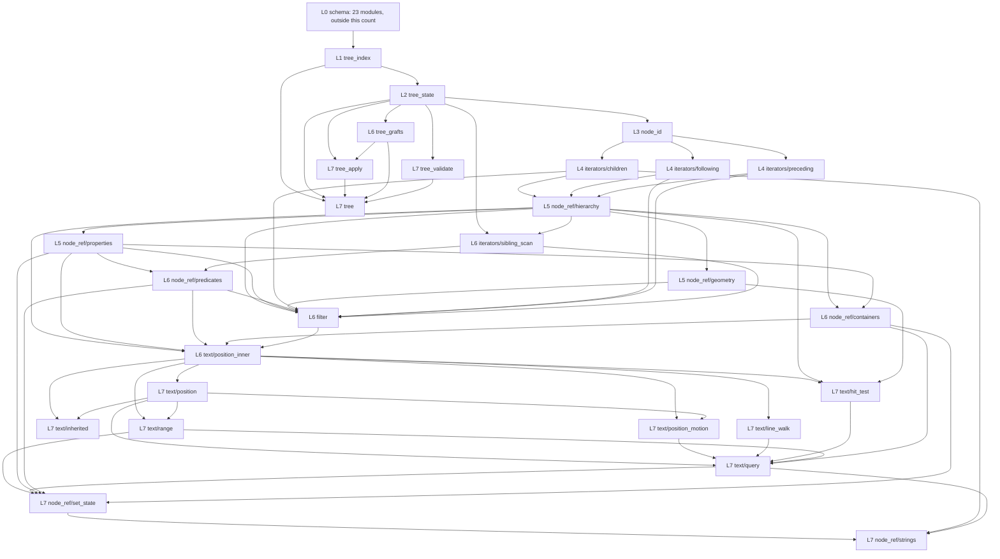

# 33 — The consumer layer interface contract

The 27 modules under `src/consumer/` import each other heavily. This document fixes the interfaces
between them before any of them is written. An agent codes against this document and not against a
neighbouring agent's guess.

**Read first.** `AGENTS.md` holds the house rules. `docs/30-port-design.md` sections 3.2 and 4 hold
the module layout, the property store and the update algorithm. `docs/10-accesskit-core.md` section
2 holds the `accesskit_consumer` types and their invariants. `docs/23-core-boundary.md` section 8
holds the 17 boundary rules. Where this document and one of those disagree, section 1.3 or section 9
says which one governs.

This document is not a port design and does not own the update algorithm; section 4.4 of
`docs/30-port-design.md` owns that. It is the shape of the seams between 27 files, so that the
integration pass is a review and not a rewrite.

## 1. The module dependency graph

### 1.1 The 27 modules, with what each one imports

Every row lists the other 26 modules it may import, and a name not in a row's import column is a
finding. All 27 also import `src/schema/`, which is layer L0.

| # | Module | Upstream range | Imports from the consumer layer | L |
|---:|---|---|---|---:|
| 1 | `tree_index.zig` | `tree.rs:13-57` | none | 1 |
| 2 | `tree_state.zig` | `tree.rs:59-83`, `:488-576` | `tree_index` | 2 |
| 3 | `node_id.zig` | `node.rs:30-77` | `tree_index`, `tree_state` | 3 |
| 4 | `iterators/children.zig` | `iterators.rs:22-77`, `:477-586` | `tree_index`, `tree_state`, `node_id` | 4 |
| 5 | `iterators/following.zig` | `iterators.rs:79-168`, `:341-407` | `tree_index`, `tree_state`, `node_id` | 4 |
| 6 | `iterators/preceding.zig` | `iterators.rs:170-254`, `:409-475` | `tree_index`, `tree_state`, `node_id` | 4 |
| 7 | `node_ref/hierarchy.zig` | `node.rs:84-289` | `tree_index`, `tree_state`, `node_id`, `iterators/children`, `iterators/following`, `iterators/preceding` | 5 |
| 8 | `node_ref/geometry.zig` | `node.rs:291-395` | `tree_index`, `tree_state`, `node_id`, `node_ref/hierarchy`, `iterators/children` | 5 |
| 9 | `node_ref/properties.zig` | `node.rs:397-547` | `tree_index`, `tree_state`, `node_id`, `node_ref/hierarchy` | 5 |
| 10 | `iterators/sibling_scan.zig` | `iterators.rs:255-340` | `tree_index`, `tree_state`, `node_id`, `iterators/children`, `iterators/following`, `iterators/preceding`, `node_ref/hierarchy` | 6 |
| 11 | `node_ref/predicates.zig` | `node.rs:548-717` | `tree_index`, `tree_state`, `node_id`, `node_ref/hierarchy`, `node_ref/properties`, `iterators/sibling_scan` | 6 |
| 12 | `node_ref/containers.zig` | `node.rs:997-1103` | `tree_index`, `tree_state`, `node_id`, `node_ref/hierarchy`, `node_ref/properties`, `node_ref/predicates`, `iterators/children`, `iterators/following` | 6 |
| 13 | `filter.zig` | `filters.rs:11-101` | `tree_index`, `tree_state`, `node_id`, `node_ref/hierarchy`, `node_ref/properties`, `node_ref/predicates`, `node_ref/geometry`, `iterators/children`, `iterators/following`, `iterators/preceding`, `iterators/sibling_scan` | 6 |
| 14 | `text/position_inner.zig` | `text.rs:16-160` | `tree_index`, `tree_state`, `node_id`, `node_ref/hierarchy`, `node_ref/properties`, `node_ref/predicates`, `node_ref/containers`, `filter` | 6 |
| 15 | `tree_grafts.zig` | `tree.rs:261-486` | `tree_index`, `tree_state`, `node_id` | 6 |
| 16 | `text/position.zig` | `text.rs:161-332` | `node_id`, `node_ref/hierarchy`, `node_ref/properties`, `node_ref/containers`, `filter`, `text/position_inner` | 7 |
| 17 | `text/position_motion.zig` | `text.rs:333-594` | `node_id`, `node_ref/hierarchy`, `node_ref/properties`, `node_ref/containers`, `text/position_inner`, `text/position` | 7 |
| 18 | `text/line_walk.zig` | `text.rs:107-141` | `node_id`, `node_ref/hierarchy`, `node_ref/properties`, `text/position_inner` | 7 |
| 19 | `text/hit_test.zig` | `text.rs:932-978` | `node_id`, `node_ref/hierarchy`, `node_ref/geometry`, `node_ref/properties`, `text/position_inner` | 7 |
| 20 | `text/inherited.zig` | `text.rs:980-1364` | `node_id`, `node_ref/hierarchy`, `node_ref/properties`, `text/position_inner`, `text/position` | 7 |
| 21 | `text/range.zig` | `text.rs:595-931` | `node_id`, `node_ref/hierarchy`, `node_ref/properties`, `node_ref/containers`, `text/position_inner`, `text/position` | 7 |
| 22 | `text/query.zig` | `text.rs:1365-1650` | `node_id`, `node_ref/hierarchy`, `node_ref/properties`, `node_ref/predicates`, `node_ref/containers`, `iterators/children`, `filter`, `text/position_inner`, `text/position`, `text/position_motion`, `text/line_walk`, `text/hit_test`, `text/range` | 7 |
| 23 | `node_ref/set_state.zig` | `node.rs:825-996` | `node_id`, `node_ref/hierarchy`, `node_ref/properties`, `node_ref/predicates`, `node_ref/containers`, `iterators/children`, `text/range`, `text/query` | 7 |
| 24 | `node_ref/strings.zig` | `node.rs:719-824` | `node_id`, `node_ref/hierarchy`, `node_ref/properties`, `node_ref/set_state`, `iterators/children`, `text/range`, `text/query` | 7 |
| 25 | `tree_validate.zig` | `tree.rs:86-123` | `tree_index`, `tree_state`, `node_id` | 7 |
| 26 | `tree_apply.zig` | `tree.rs:124-260` | `tree_index`, `tree_state`, `node_id`, `tree_grafts` | 7 |
| 27 | `tree.zig` | `tree.rs:578-711` | `tree_index`, `tree_state`, `node_id`, `tree_apply`, `tree_grafts`, `tree_validate` | 7 |

### 1.2 The same graph as a diagram



### 1.3 The layers, and the three edges the record does not state

The tree core is L1 and L2, `node_ref/` is L5 and L6, `text/` is L6 and L7, and `iterators/` is at
L4 and L6, below the module that returns its iterator types.

**An iterator reads `NodeState` fields and does not call `node_ref/`.** At L4 each iterator reads
`NodeState.parent_and_index` and the `children` property directly. It does not call
`parentAndIndex`, because that operation lives at L5 and L5 returns the iterator this L4 module
defines. `iterators.rs:261` and `:302` call `current.children()` and `current.following_siblings()`,
free of ordering questions in Rust and not in Zig.

**`indexPath` and `relativeIndexPath` are in `node_ref/containers.zig`.** Section 3.2 assigns
`node.rs:825-1012` to `node_ref/set_state.zig`, which includes the two at `:997` and `:1001`. They
are read by `text/position_inner.zig:312` and by `text/range.zig`. If they sat in
`node_ref/set_state.zig`, that module would import `text/query.zig` for `supportsTextRanges` at
`node.rs:857` and `text/query.zig` would import it back, so the pair could not be analysed
independently. The range becomes `node.rs:997-1103`.

**`FilterResult` and `FilterFn` are in `node_id.zig`, not `filter.zig`.** Section 3.2 gives
`FilterResult` to `filter.zig`. `commonFilter` at `filters.rs:54` calls `is_focused`, `is_hidden`,
`is_graft`, `role`, `parent`, `filtered_parent`, `clips_children`, `bounding_box` and both filtered
sibling iterators, so `filter.zig` sits above `node_ref/` and `iterators/`. Every one of those takes
a `FilterFn`, so `FilterFn` sits below them, and `FilterFn` names `FilterResult`. Placing both in
`node_id.zig` makes the graph acyclic and placing them in `filter.zig` makes it a two-way import.
`node_ref/predicates.zig` and `iterators/sibling_scan.zig` need both as well.

## 2. The core state types, spelled exactly

Every declaration below is the one to copy. A module that needs one of these types imports it and
does not declare a second copy. The prose after the block is the contract, and section 4 fixes the
sentences that go in the doc comments.

**Correction, 2026-10-06, on the two `cloneInto` signatures.** This block first spelled both as
`cloneInto(source, gpa, out)`, and the built code followed it. Section 4 rule 1 below says `gpa` is
the first parameter, so that spelling put the allocator third and contradicted the rule in the same
document. The tree now spells both as `cloneInto(self, gpa, source)`, which keeps the destination as
the receiver, so the method call reads `destination.cloneInto(gpa, &source)`, and puts the allocator
immediately after it. ziglint rule Z023 is what settles it: it reports an `Allocator` parameter that
follows an `other` parameter, and it reported `tree_index.zig:262` and `tree_state.zig:378` for
exactly this. The rule is `ParamKind.order` at `tools/ziglint/src/Linter.zig:1110`, where `allocator`
is 2 and `other` is 4, so an allocator after any other parameter is out of order.

```zig
// src/consumer/tree_index.zig — L1. Upstream: tree.rs:13-57, node.rs:29-55.
/// The index this process assigned to one tree id. Upstream `struct TreeIndex(u32)`.
pub const TreeIndex = enum(u32) {
    _,
    pub fn init(value: u32) TreeIndex {
        return @enumFromInt(value);
    }
    pub fn value(self: TreeIndex) u32 {
        return @intFromEnum(self);
    }
};
/// A node id namespaced by its tree. Borrows nothing, so a copy is the same node.
pub const FullNodeId = struct {
    local: NodeId,
    tree_index: TreeIndex,
    pub fn init(local_id: NodeId, tree_index: TreeIndex) FullNodeId {
        return .{ .local = local_id, .tree_index = tree_index };
    }
    /// The same tree, a different local id.
    pub fn withSameTree(self: FullNodeId, local_id: NodeId) FullNodeId {
        return .{ .local = local_id, .tree_index = self.tree_index };
    }
};
/// The parent and this node's index in the parent's `children` list.
pub const ParentAndIndex = struct { parent_id: FullNodeId, index: usize };
pub const TreeIdIndexMap = std.array_hash_map.Auto(TreeId, TreeIndex);
pub const TreeIdByIndexMap = std.array_hash_map.Auto(TreeIndex, TreeId);
/// The two directions of the index assignment. Upstream: tree.rs:17-21.
pub const TreeIndexMap = struct {
    id_to_index: TreeIdIndexMap = .empty,
    index_to_id: TreeIdByIndexMap = .empty,
    next: u32 = 0,
    pub fn getOrCreateIndex(gpa: std.mem.Allocator, self: *TreeIndexMap, id: TreeId) std.mem.Allocator.Error!TreeIndex {}
    pub fn getIndex(self: *const TreeIndexMap, id: TreeId) ?TreeIndex {}
    pub fn getId(self: *const TreeIndexMap, index: TreeIndex) ?TreeId {}
    pub fn deinit(self: *TreeIndexMap, gpa: std.mem.Allocator) void {}
    pub fn cloneInto(self: *TreeIndexMap, gpa: std.mem.Allocator, source: *const TreeIndexMap) std.mem.Allocator.Error!void {}
};
comptime {
    std.debug.assert(@sizeOf(TreeIndex) == 4 and @alignOf(TreeIndex) == 4);
    std.debug.assert(@sizeOf(FullNodeId) == 16 and @alignOf(FullNodeId) == 8);
}

// src/consumer/tree_state.zig — L2. Upstream: tree.rs:59-83, node.rs:58-61.
pub const NodeMap = std.array_hash_map.Auto(FullNodeId, NodeState);
pub const TreeIdMap = std.array_hash_map.Auto(TreeId, SubtreeState);
pub const TreeIdNodeMap = std.array_hash_map.Auto(TreeId, FullNodeId);
pub const NodeIdSet = std.array_hash_map.Auto(FullNodeId, void);
pub const TreeIdSet = std.array_hash_map.Auto(TreeId, void);
/// One node as the tree holds it: where it sits, and its data.
pub const NodeState = struct { parent_and_index: ?ParentAndIndex, data: Node };
/// The root and the focus of one grafted subtree.
pub const SubtreeState = struct { root: FullNodeId, focus: FullNodeId };
/// What one update changed. A caller-passed value, not a field.
pub const InternalChanges = struct {
    added_node_ids: NodeIdSet = .empty,
    updated_node_ids: NodeIdSet = .empty,
    removed_node_ids: NodeIdSet = .empty,
    pub fn deinit(self: *InternalChanges, gpa: std.mem.Allocator) void {}
};
/// The whole tree an application reads. Upstream: tree.rs:66-72.
/// I1 exactly one node has `parent_and_index == null`, and it is `root`.
/// I2 every id named in some `children` list has a `NodeState`.
/// I3 every non-root `TreeId` is in `graft_parents` once, and its subtree root's
///    parent is that graft node at index 0.
/// I4 `focus` is a key of `nodes`.
pub const TreeState = struct {
    nodes: NodeMap = .empty,
    info: TreeInfo = .{},
    root: FullNodeId = .{ .local = .{ .value = 0 }, .tree_index = .init(0) },
    focus: FullNodeId = .{ .local = .{ .value = 0 }, .tree_index = .init(0) },
    is_host_focused: bool = false,
    subtrees: TreeIdMap = .empty,
    graft_parents: TreeIdNodeMap = .empty,
    tree_index_map: TreeIndexMap = .empty,
    /// `Tree.deinit` is the only caller. See section 4 for both of these.
    pub fn deinit(self: *TreeState, gpa: std.mem.Allocator) void {}
    pub fn cloneInto(self: *TreeState, gpa: std.mem.Allocator, source: *const TreeState) std.mem.Allocator.Error!void {}
    // The queries. None allocates and none returns an error set: a missing node is null.
    pub fn hasNode(self: *const TreeState, id: FullNodeId) bool {}
    pub fn nodeById(self: *const TreeState, id: FullNodeId) ?NodeRef {}
    pub fn nodeByTreeLocalId(self: *const TreeState, local: NodeId, tree: TreeId) ?NodeRef {}
    pub fn rootId(self: *const TreeState) FullNodeId {}
    pub fn root(self: *const TreeState) NodeRef {}
    pub fn subtreeRoot(self: *const TreeState, tree_id: TreeId) ?FullNodeId {}
    pub fn isHostFocused(self: *const TreeState) bool {}
    pub fn focusIdInTree(self: *const TreeState) FullNodeId {}
    pub fn focusInTree(self: *const TreeState) NodeRef {}
    pub fn focusId(self: *const TreeState) ?FullNodeId {}
    pub fn focus(self: *const TreeState) ?NodeRef {}
    /// Walks the parent chain, so it takes a section 7 bound.
    pub fn activeDialog(self: *const TreeState) QueryError!NodeRef {}
    pub fn toolkitName(self: *const TreeState) []const u8 {}
    pub fn toolkitVersion(self: *const TreeState) ?[]const u8 {}
    /// The local id and the tree id behind a `FullNodeId`.
    pub fn locateNode(self: *const TreeState, id: FullNodeId) ?struct { local_id: NodeId, tree_id: TreeId } {}
};

// src/consumer/node_id.zig — L3. Upstream: node.rs:29-82, filters.rs:11-15.
/// The outcome of one filter test. Three tags, so `enum(u2)` and one byte.
pub const FilterResult = enum(u2) { include, exclude_node, exclude_subtree };
/// A filter. A plain function pointer, never a closure: a capture hides the sequence. A
/// filter needing per-call state takes a `context: ?*anyopaque`. None does.
pub const FilterFn = *const fn (node: NodeRef) FilterResult;
/// A borrowed handle to one node. Upstream `NodeRef<'a>`, node.rs:78-82. See section 4.
pub const NodeRef = struct {
    tree_state: *const TreeState,
    id: FullNodeId,
    state: *const NodeState,
    /// The node this handle names.
    pub fn id(self: NodeRef) FullNodeId {
        return self.id;
    }
    /// Borrows the node data, valid only as long as `self` is.
    pub fn data(self: NodeRef) *const Node {
        return &self.state.data;
    }
    /// The only way to build one. Null when `id` is not in `state.nodes`.
    pub fn init(state: *const TreeState, id: FullNodeId) ?NodeRef {
        const node_state = state.nodes.get(id) orelse return null;
        return .{ .tree_state = state, .id = id, .state = node_state };
    }
};

// src/consumer/tree.zig — L7. Upstream: tree.rs:578-588.
/// The tree an application reads. See section 4 for the allocator rule.
pub const Tree = struct {
    gpa: std.mem.Allocator,
    state: TreeState,
    next_state: TreeState,
    /// On any error nothing is allocated and the caller keeps `initial_update`.
    pub fn init(gpa: std.mem.Allocator, initial_update: TreeUpdate, is_host_focused: bool) UpdateError!Tree {}
    /// Releases both states and the allocator handle. A second call is a double free.
    pub fn deinit(self: *Tree) void {}
    /// Borrows the committed state, valid until the next update call.
    pub fn stateOf(self: *const Tree) *const TreeState {
        return &self.state;
    }
    /// Applies `update` to `next_state`, folds it into `state`, then calls `handler`.
    pub fn updateAndProcessChanges(self: *Tree, update: TreeUpdate, handler: *const TreeChangeHandler) UpdateError!void {}
    /// Records the host focus flag, then calls `handler` for the focus change only.
    pub fn updateHostFocusStateAndProcessChanges(self: *Tree, is_host_focused: bool, handler: *const TreeChangeHandler) UpdateError!void {}
};
/// Receives what one update changed. Four optional slots; `null` selects the
/// default and the default is silence. The only vtable here; rule C6 counts them.
pub const TreeChangeHandler = struct {
    ptr: *anyopaque,
    node_added: ?*const fn (ptr: *anyopaque, node: NodeRef) void = null,
    node_updated: ?*const fn (ptr: *anyopaque, old: NodeRef, new: NodeRef) void = null,
    /// `null` on either side means focus was lost or gained.
    focus_moved: ?*const fn (ptr: *anyopaque, old: ?NodeRef, new: ?NodeRef) void = null,
    node_removed: ?*const fn (ptr: *anyopaque, node: NodeRef) void = null,
};

// src/consumer/text/position_inner.zig — L6, and text/range.zig — L7.
/// A position inside one text run. Upstream `InnerPosition<'a>`, text.rs:16-19.
pub const InnerPosition = struct { node: NodeRef, character_index: usize };
/// A position inside a document. Upstream `Position<'a>`, text.rs:161-165.
pub const Position = struct { root_node: NodeRef, inner: InnerPosition };
/// The ordering key of a position: the child-index path, then the character index.
pub const ComparablePath = struct {
    gpa: std.mem.Allocator,
    indices: std.ArrayList(usize),
    character_index: usize,
    pub fn deinit(self: *ComparablePath) void {}
    /// Shorter path first, then character index.
    pub fn order(self: ComparablePath, other: ComparablePath) std.math.Order {}
};
/// One text range. Upstream `Range<'a>`, text.rs:614-618.
pub const Range = struct { node: NodeRef, start: InnerPosition, end: InnerPosition };
/// A range that survives its tree. Upstream `WeakRange`, text.rs:898-903. Its
/// positions are `TextPosition` from `schema/values.zig`, which `text.rs:6` imports
/// under the name `WeakPosition`.
pub const WeakRange = struct {
    node_id: FullNodeId,
    start: TextPosition,
    end: TextPosition,
    start_comparable: ComparablePath,
    end_comparable: ComparablePath,
    pub fn deinit(self: *WeakRange) void {}
};
/// One property across a range: one value or mixed. Holds no memory.
pub fn RangePropertyValue(comptime T: type) type {
    return union(enum) { single: ?T, mixed };
}
```

### 2.1 Five notes on the declarations

**`TreeIndex` is a type, not a `u32`,** because a bare `u32` lets a child index reach a tree
index. `docs/30-port-design.md` section 4.1 writes `tree_index: u32`, but section 3.2 gives
`tree_index.zig` the ownership of a type named `TreeIndex` and `docs/10-accesskit-core.md:398`
declares it as `enum(u32) { _ }`. The field name and order are `docs/30-port-design.md`'s.

**`FullNodeId` is a plain `struct`.** `docs/10-accesskit-core.md:400` declares it `extern`, for a
measured 16 bytes at alignment 8. A plain `struct` gives the same numbers under that layout rule,
and `extern` is required only for a type that crosses the C boundary. `FullNodeId` does not.

**`PropertyId` has exactly 87 tags and no `Unset`.** Absence is the `null` that `Properties.get`
returns, so an 88th sentinel would be a variant with no writer, and a variant nobody can construct
is a variant nobody tests. With 87 tags the compiler rejects an out-of-range id that an 88th tag
would accept. The count is pinned once, in the keystone `src/schema/props/table.zig`, by an
assertion that `propertyIdCount == 87` and by the descriptor sweep over `@typeInfo(PropertyId)`,
which asserts that each of the 87 tags appears exactly once. No consumer module declares
`PropertyId`, `PropertyValue` or `Property`. It calls the accessors in `src/schema/props/`.

**`PropertyValue` has two forms and a consumer module sees one.** `src/schema/props/table.zig`
owns the store value, a plain tagged union holding `[]const u8` for a string and `std.ArrayList`
for a list. `src/capi/marshal.zig` owns the ABI union, which holds `[*c]const u8` for a string and
`[*c]T` with a count for a list, because an extern union may hold neither a slice nor a plain
struct. No module under `src/consumer/` names the ABI union, and a `[ *c ]` pointer in the store
is a defect.

**The two large option payloads are borrows.** `?*const Affine` and `?*const TextSelection` are
what `src/schema/props/option.zig` returns, because upstream splits these four getters across two
families, `option_ref_type_getters` at `accesskit/src/lib.rs:1977` returning references and
`copy_type_getters` at `:1988` returning copies, and a split the source states is faithful
translation. `bounds` and `treeId` return copies. A returned `*const Affine` borrows from the store
and the next write to that property invalidates it. That is the third case of section 4.

## 3. The import direction rules, as prohibitions

A prohibition is checkable by reading one file. Each row names what breaks when it is broken. The
block below is data, not a file to add, and `check` is the grep or the reading that settles each
row.

```zig
pub const ImportRule = struct {
    importer: []const u8,
    forbidden: []const u8,
    breaks: []const u8,
    check: []const u8,
};
// The layer edges. An import points from a higher layer to a lower one.
pub const layer_rules = [_]ImportRule{
    .{ .importer = "node_id.zig", .forbidden = "iterators/, node_ref/, text/, filter.zig, tree.zig",
.breaks = "NodeRef gains a second constructor and a second place to look for one.",
.check = "Read the import block: three names." },
    .{ .importer = "iterators/{children,following,preceding}.zig", .forbidden = "node_ref/",
.breaks = "An iterator needs parentAndIndex and node_ref/hierarchy.zig returns these iterators, so the pair is a two-way import.",
.check = "Grep for hierarchy.zig." },
    .{ .importer = "iterators/sibling_scan.zig", .forbidden = "predicates.zig, containers.zig, filter.zig, text/",
.breaks = "nextFilteredSibling calls children and followingSiblings and predicates calls nextFilteredSibling, so the pair is a two-way import.",
.check = "Grep for predicates.zig and filter.zig." },
    .{ .importer = "node_ref/properties.zig", .forbidden = "predicates.zig, containers.zig, filter.zig, text/",
.breaks = "An inherited walk needs parent(), and parent() returns the iterators predicates and containers own.",
.check = "Grep for predicates.zig." },
    .{ .importer = "node_ref/predicates.zig", .forbidden = "containers.zig, filter.zig, text/, set_state.zig, strings.zig",
.breaks = "supportsAction consults a filter and the filter calls clips_children, so the pair is a two-way import.",
.check = "Grep for filter.zig." },
    .{ .importer = "node_ref/containers.zig", .forbidden = "filter.zig, text/, set_state.zig, strings.zig",
.breaks = "hasValue needs supportsTextRanges and text needs indexPath here, so the pair is a two-way import.",
.check = "Grep for query.zig and strings.zig." },
    .{ .importer = "text/position_inner.zig", .forbidden = "position.zig, position_motion.zig, line_walk.zig, range.zig, query.zig, set_state.zig, strings.zig",
.breaks = "InnerPosition is the field of Position and Range, so one struct size would depend on a module it does not own.",
.check = "Grep for position.zig." },
    .{ .importer = "text/range.zig", .forbidden = "query.zig, set_state.zig, strings.zig",
.breaks = "writeValue needs documentRange and query needs Range, so the pair is a two-way import.",
.check = "Grep for query.zig." },
    .{ .importer = "tree_apply.zig", .forbidden = "tree.zig, tree_validate.zig",
.breaks = "Tree.update calls applyUpdate and applyUpdate needs the state Tree owns, so the pair is a two-way import.",
.check = "Grep for tree.zig." },
    .{ .importer = "tree_grafts.zig", .forbidden = "tree_apply.zig, tree.zig, tree_validate.zig",
.breaks = "The removal and graft passes run inside applyUpdate, so the docs/30 section 3.2 split becomes a cycle.",
.check = "Grep for tree_apply.zig." },
};
// The schema boundary. Every `src/consumer/` module may import `src/schema/`.
// No `src/schema/` module may import `src/consumer/`.
pub const schema_rules = [_]ImportRule{
    .{ .importer = "src/schema/", .forbidden = "consumer/",
.breaks = "The schema layer stops knowing only values, so a schema test needs a tree.",
.check = "One grep per file for consumer/." },
    .{ .importer = "src/consumer/root.zig, src/schema/root.zig", .forbidden = "any computation, and any name that is not a re-export",
.breaks = "A root module that computes is a module with no budget, no upstream range and no owner.",
.check = "Read the file. It declares re-exports only." },
    .{ .importer = "src/schema/node.zig", .forbidden = "update.zig",
.breaks = "The two could not be analysed independently. TreeUpdate carries Node values, so one direction is a cycle.",
.check = "Grep for update.zig. Rule from docs/30 section 3.1." },
};
// The platform boundary, from docs/23-core-boundary.md section 8.
pub const platform_rules = [_]ImportRule{
    .{ .importer = "every file under src/schema/ and src/consumer/", .forbidden = "src/adapters, src/toolkit, or an adapter package name",
.breaks = "Rule B1. The core half learns a platform and stops being testable without one.",
.check = "One grep per file." },
    .{ .importer = "every file under src/consumer/", .forbidden = "std.os, std.posix, std.c, zio",
.breaks = "Rule B2. The layer grows a global runtime, and a unit test then needs an operating system.",
.check = "One grep per file." },
    .{ .importer = "every file under src/consumer/", .forbidden = "io: std.Io as a parameter, and std.Io as any other type",
.breaks = "Rule B2 read strictly. ids.zig:84 uses std.Io.Writer, so a grep for std.Io alone fails a correct file.",
.check = "Grep for `: std.Io` and for `std.Io,`." },
    .{ .importer = "every file under src/consumer/", .forbidden = "@import("builtin")",
.breaks = "Rule B3. The answer comes from the build instead of from the call.",
.check = "One grep per file." },
    .{ .importer = "every allocating function under src/consumer/", .forbidden = "no allocator, where the function allocates and no field holds one",
.breaks = "Rule B4. Rust takes the allocator from a thread-local, so a growing function has nothing to free with.",
.check = "Read the signature." },
    .{ .importer = "every file under src/consumer/", .forbidden = "page_allocator, std.heap, std.time, std.process.getEnvVarOwned, std.fs.cwd",
.breaks = "Rules C3 and C4. A global allocator and a clock read are what this layer exists to keep out.",
.check = "One grep per file." },
    .{ .importer = "every type under src/consumer/", .forbidden = "anytype, ?*anyopaque in a field, a platform handle",
.breaks = "Rule C1. An opaque field hides the layout, so no comptime assertion can pin the size.",
.check = "Read the struct declarations." },
    .{ .importer = "every file under src/consumer/", .forbidden = "pub const Tree = , and any alias of a schema name",
.breaks = "Rule C5. One item keeps two names and a reader cannot tell which is the declaration.",
.check = "Grep for `pub const Tree =`." },
    .{ .importer = "every file under src/consumer/", .forbidden = "panic, unreachable, catch unreachable, catch continue, and `_ =` on a fallible call",
.breaks = "Rule C8. An abort is not a value, so a caller cannot handle a malformed update.",
.check = "One grep per file for the four names." },
    .{ .importer = "every loop under src/consumer/", .forbidden = "while (true), and a loop with no named bound",
.breaks = "Rule C7. A walk that reaches user data has no termination argument, so a bad tree hangs.",
.check = "Read every while and every for. Section 7 names the bounds." },
};
// The receiver rule, which decides the shape of section 8.
pub const receiver_rules = [_]ImportRule{
    .{ .importer = "every file except the one declaring the struct body", .forbidden = "a method on Node, NodeRef, TreeState, Tree, Range, Properties, or Position",
.breaks = "A Zig method is declared only inside its struct body, so an operation written elsewhere is not callable.",
.check = "Read the first parameter of every `pub fn `. It is the receiver." },
    .{ .importer = "every file under src/consumer/", .forbidden = "a closure, a captured variable, or a nested struct carrying per-call state",
.breaks = "A capture hides the sequence, and AGENTS.md section 3 requires state as a parameter.",
.check = "Grep for `struct {` inside a function body." },
    .{ .importer = "every file under src/consumer/", .forbidden = "a file-scope var, and a global",
.breaks = "AGENTS.md section 3 forbids a global runtime, and a file-scope var is one a test cannot replace.",
.check = "One grep per file for `^var ` and `^pub var `." },
};
/// Every rule above, in the order a reviewer reads them.
pub const import_rules = layer_rules ++ schema_rules ++ platform_rules ++ receiver_rules;
```

## 4. The ownership contract for the tree

Three cases, and every shared type falls into exactly one of them.

**A type that holds a `gpa`.** `Properties`, `Tree` and `ComparablePath`. The value keeps the
allocator it was created with, so a setter on such a type takes no allocator and `deinit` takes
none. The stored allocator must stay valid for the life of the value and must be the allocator that
released the memory this value last held. A copy of the handle is not a second owner, so a copy must
not be deinitialised separately. `docs/31-c-abi-design.md` record C states the rule for the handles
and `docs/30-port-design.md` section 4.3 states it for `Properties`. `Tree` holds it because a
handler reaches `updateAndProcessChanges` through a fixed vtable signature, so the allocator travels
inside the handle.

**A type that borrows from another.** `NodeRef.state`, `NodeRef.tree_state`, `TreeState.info`,
`toolkitName`, `toolkitVersion` and the two option payloads of section 2.1. The borrow ends at the
call that mutates the owner, and the doc comment names it.

**A type that hands out memory a caller must release.** `label(gpa)`, `description(gpa)`,
`value(gpa)`, `text(gpa)`, `indexPath(gpa)`, `relativeIndexPath(gpa)` and `boundingBoxes(gpa)`. Each
returns memory the caller owns and releases with the same allocator. A null return is not a failure:
it means the node declares no such text, so the caller frees nothing.

The sentences that go in the doc comments, written out once so 27 modules do not each phrase them
differently:

```zig
/// `Properties` owns every buffer `items` grows and stores the allocator that
/// grew them. The stored allocator must stay valid for the life of the value,
/// and it must be the allocator that released the memory this value last held,
/// or `deinit` is a mismatched free.
///
/// Copying a `Properties` copies the handle, not the storage, so a copy is not
/// a second owner and must not be deinitialised separately.
pub const Properties = struct {
    gpa: std.mem.Allocator,
    items: std.ArrayList(Property) = .empty,
    /// Releases every property value and the backing array. The value is
    /// unusable afterwards and a second call is a double free.
    pub fn deinit(self: *Properties) void {}
};
// `NodeRef` borrows a node out of a `TreeState` and owns nothing. The borrow ends at
// the next call that can grow `TreeState.nodes`, because growing the map moves its
// entries and `state` would dangle. Rebuild every `NodeRef` after an update.
// `Tree` owns both states and the allocator that grew them. `Tree` has no copy
// operation, because two owners of one set of nodes release it twice.
// Returns a buffer the caller owns. Release it with the same `gpa`. A null return means
// the node declares no such text, so there is nothing to release. Nothing invalidates
// the result: it is a copy.
// Borrows a slice out of the state. It stays valid until the next call that writes
// `TreeState.info`, which is an `update` carrying a `TreeInfo`. The same sentence covers
// the borrowed `Affine`, invalidated by the next write to that property.
pub fn transform(properties: *const Properties) ?*const Affine {};
```

**`addNode` releases the entry it overwrites.** Upstream `add_node` at `tree.rs:219-223` puts a
fresh node over whatever the map held, and `docs/10-accesskit-core.md` section 4.8 rule 3 says the
previous buffers for that id are dropped. `addNode` therefore calls `entry.value.data.deinit()`
before the put, with no allocator, because `Properties` holds one. The reuse path is the other one:
`docs/30-port-design.md` section 4.3 records `slot.data = try node_data.cloneInto(state.gpa,
&slot.data)`, and that line keeps every buffer.

**A `TreeState` has no shallow copy.** `Tree.init` seeds `next_state` with
`next_state.cloneInto(gpa, &state)`, which is what upstream `state.clone()` at `tree.rs:613` does. A
plain struct assignment would share all five maps' entries, and one `deinit` would free memory the
other still reads.

## 5. The error sets, spelled exactly

Two sets. Every function that returns one returns the set named here, never `anyerror`.

```zig
// src/consumer/tree.zig
/// Failures of `Tree.init`, `Tree.updateAndProcessChanges`,
/// `Tree.updateHostFocusStateAndProcessChanges` and the update algorithm they call.
/// The first thirteen tags are conditions a platform can send. The remaining two
/// come from the port: `NodeMissingFromState` replaces an `.unwrap()` at tree.rs:367
/// and `GraftChainTooLong` replaces an unbounded walk.
///
/// The thirteen platform tags replace the 15 upstream `panic!` sites in
/// `accesskit_consumer/src/tree.rs` outside test code. `grep -c` reports 21 hits,
/// of which 6 sit after `#[cfg(test)]` at tree.rs:735. Two pairs collapse, `:211`
/// with `:273` and `:191` with `:449`, because each pair is one condition, so 15
/// sites give 13 tags. The other 2 of the 19 sites sit at text.rs:256, `:278`,
/// `:1600` and `:1639` and give the tags in `QueryError`.
pub const UpdateError = error{
    NoRootTree, // `Tree.init` given an update whose `tree` is absent. tree.rs:594
    NotTheRootTree, // `Tree.init` given a subtree update. tree.rs:599
    RootNotInTree, // the root has no NodeState. tree.rs:88
    FocusNotInTree, // the recorded focus has no NodeState. tree.rs:91
    GraftWithoutSubtree, // focus on a graft node with no subtree. tree.rs:112
    SubtreeWithoutGraft, // subtree pushed with no graft node. tree.rs:135
    SubtreeDoesNotExist, // subtree updated before its tree data. tree.rs:142
    CannotGraftTheRootTree, // an update grafts the root tree. tree.rs:188
    DuplicateGraftParent, // two graft parents, or a second at commit. :191, :449
    GraftWithChildren, // tree_id and a non-empty children list. :211, :273
    DuplicateChild, // one node names the same child twice. tree.rs:236
    OrphanNode, // a node is neither present nor a child. tree.rs:318
    OrphanChild, // a child id is neither present nor a node. tree.rs:325
    NodeMissingFromState, // an internal removal found no node. tree.rs:367
    GraftChainTooLong, // the bound in section 7.1 row 1. No upstream site.
    OutOfMemory,
};
/// Failures of every query that walks the tree. The first six tags are the set
/// `docs/30-port-design.md` section 4.5 records. `TreeCycle` is this document's
/// addition: the six walks in section 7.1 rows 5 to 9 must report exhaustion and
/// rule C8 bans `unreachable`, so they need a tag. It joins this set, so one catch.
pub const QueryError = error{
    InvalidPosition, // text.rs:256, :278
    IndexOutOfRange, // text.rs:1600, :1639
    LineChainCycle, // replaces the unbounded walk at text.rs:117, :131
    WrongPropertyKind, // upstream drops this value inside Properties.get_mut
    NoSuchNode, // the state holds no node for the id
    TreeCycle, // a parent, child or transform walk hit its bound. No upstream site.
    OutOfMemory,
};
comptime {
    // Every tag is named by a test. This is the sweep AGENTS.md section 3 asks for,
    // and it is what makes a new tag without a test a compile error.
    inline for (@typeInfo(UpdateError).error_set.keys) |key| {
        _ = key;
    }
    inline for (@typeInfo(QueryError).error_set.keys) |key| {
        _ = key;
    }
    // 13 platform tags, 2 port tags and OutOfMemory. A delete is a compile error.
    std.debug.assert(@typeInfo(UpdateError).error_set.fields.len == 16);
    std.debug.assert(@typeInfo(QueryError).error_set.fields.len == 7);
}
```

**What survives each tag.** At formatted revision `d854c8b0d77385cf8c0c5983832369923fdef2d5`, `Tree` leaves committed `state` unchanged and calls no handler slot when an update or host-focus call returns an error (`src/consumer/tree.zig:455-460,481-510,606-655,657-708`).
The historical core owner revision is `f3be8aa12fb1d210d1a4cf33139dfa25d517e7de`. Formatting adds no execution proof.
An update error can leave `next_state` partly written (`src/consumer/tree.zig:123-128,443-451`).
Before the next owned update, borrowed update, or host-focus call, `Tree` restores dirty `next_state` from `state` (`src/consumer/tree.zig:443-452,467-476`).
Therefore, `error.GraftChainTooLong` and `error.NodeMissingFromState` do not require a caller to drop the public `Tree` (`src/consumer/tree.zig:443-452,467-476`).
Lower-level `applyUpdateBorrowed` remains nontransactional, so its caller must discard partial state and change records after an error (`src/consumer/tree_apply.zig:115-121`).
On `error.OutOfMemory` during `cloneInto`, the destination keeps its old buffers because `cloneInto` swaps its scratch copy only after success (`src/consumer/tree_state.zig:377-417`).

**The rule for adding a tag.** A tag is a change to an error union, so a caller that matches every
tag by name stops compiling. That is the intended effect, and it is why this set is written out
rather than left as `anyerror`: adding `OrphanChild` must break every caller that treated the update
as atomic. Each new tag needs a test that reaches it, and a line here naming the site it replaces.

## 6. The allocator and `io` rules for this layer

The rule, so an agent can apply it to a function this document does not name:

- A function that allocates takes `gpa: std.mem.Allocator` **as its first parameter**, per `AGENTS.md:99`.

  > **Correction, 2026-10-05, after the layer was built.** The second sentence
  > once read "It is the first parameter on a method. On a free function the
  > receiver comes first and `gpa` comes second." That was wrong, it contradicted
  > the worked shape three lines below it, and it contradicted `AGENTS.md:99`.
  >
  > **`gpa` first on an allocating free function.** The single exception is a
  > **method**, which takes the receiver first, because Zig builds method-call
  > syntax only in that order and a method-shaped name with the allocator in
  > front would have to be called qualified. So `applyUpdate(gpa, state, update,
  > changes)` and `label(gpa, node)`, against `map.getOrCreateIndex(gpa, id)` and
  > `out.cloneInto(gpa, &source)`.
- A function that can block takes `io: std.Io`. None in this layer qualifies, so none takes one.
- A pure query takes neither. A function that allocates and takes a callback takes both.

```zig
// src/consumer/node_ref/strings.zig — three shapes, one per rule.
/// A pure query. It hands back a borrow of the store's buffer, so it takes neither
/// parameter and returns null when the node declares no label.
pub fn rawLabel(node: NodeRef) ?[]const u8 {
    return props.label(node.data().properties);
}
/// Allocates, so it takes `gpa` first and returns the allocator's error set and nothing
/// wider. Null means no label, so the caller frees nothing.
pub fn label(gpa: std.mem.Allocator, node: NodeRef) std.mem.Allocator.Error!?std.ArrayList(u8) {
    _ = gpa;
    return null;
}
/// Streams into a sink the caller owns, so it takes neither `gpa` nor `io`: it writes
/// to a buffer the caller holds and blocks on nothing. `*std.Io.Writer` is a sink, not
/// a capability: a writer is where bytes go, and `std.Io` is the backend behind it.
pub fn writeLabel(node: NodeRef, writer: *std.Io.Writer) std.Io.Writer.Error!bool {
    _ = node;
    return false;
}
/// A mutator of a type that holds its own allocator, so it takes no `gpa`.
pub fn setLabelledBy(properties: *Properties, values: []const NodeId) void {
    _ = properties;
}
// Nothing in this layer opens a file, reads a clock or waits on a bus, so no
// consumer function has this signature.
pub fn notInThisLayer(io: std.Io) void {
    _ = io;
}
```

**`zio` appears nowhere in this layer**, for three reasons, one from each document.
`docs/23-core-boundary.md` rule B2 lists `zio` in the same grep as `std.os`, `std.posix` and
`std.c`, so a file that names it fails the gate stage. `docs/30-port-design.md` section 3.5 states
that no published signature names a `zio` or `goose` type, because a module's import table is per
module and not transitive, so such a signature would make a consumer add the dependency. And section
2.1 rule R1 states that the capability parameter is `std.Io` and never `*zio.Runtime`, because
`std.Io.Threaded` has to stay usable as a test backend. A unit test of this layer therefore builds
no runtime at all.

**Why no function takes `io`.** `accesskit_consumer/src/lib.rs:9` is `#![no_std]` with `extern crate
alloc` and nothing else, and `docs/10-accesskit-core.md` section 7.1 records 0 items of class S in
the two neutral crates, so no function there performs I/O. The first `io` parameter in the port
belongs to an adapter context.

## 7. The nine bounded walks

`docs/10-accesskit-core.md` section 7.6 records nine upstream loops whose only termination argument
is that the tree is acyclic. Nine is the right count: the twenty-one `while` loops of the consumer
crate include three bounded by the length of a finite input, and the remaining eighteen are bounded
by a comptime domain. Each bound below is a named value with its derivation and an assertion that
pins it.

```zig
// Bound 1 of 9. The graft chain `computeEffectiveFocus` follows, tree.rs:101-120.
// Each step moves to a node whose `tree_id` is set and every non-root tree id is in
// `graft_parents` once, so the chain is one step per subtree plus one final step.
pub fn graftChainStepBound(registered_subtree_count: usize) usize {
    return registered_subtree_count + 1;
}
// Bounds 2 and 3 of 9. The two removal stacks, tree.rs:354-380 and tree.rs:395-419.
// Each iteration that succeeds removes one entry from `nodes`, so at most
// `node_count` can succeed and the next pop finds nothing. The count is captured at
// entry, because the map shrinks while the walk runs.
pub fn removalStepBound(node_count_at_entry: usize) usize {
    return node_count_at_entry;
}
// Bound 4 of 9. The subtree removal cursor, tree.rs:425-445. The list grows
// while it is walked and each subtree is queued once, so the bound is the list
// length re-read each iteration. Exhaustion is the ordinary exit, so no tag.
pub fn subtreeRemovalBound(list_len_at_this_iteration: usize) usize {
    return list_len_at_this_iteration;
}
// Bounds 5 to 9 of 9. The five ancestor and child walks, node.rs:143, :240, :259,
// :278, :302 and :312. Each step moves to a different node and the tree holds at
// most `node_count`, so a walk cannot take more. A cycle repeats a node, and the
// count catches a repeat.
pub fn treeWalkStepBound(node_count: usize) usize {
    return node_count;
}
comptime {
    // The derivations, pinned at zero and at a size a test uses. The last line says
    // the graft chain is strictly longer than the node bound, so they are not one constant.
    std.debug.assert(graftChainStepBound(0) == 1);
    std.debug.assert(graftChainStepBound(65_535) == 65_536);
    std.debug.assert(removalStepBound(65_536) == 65_536);
    std.debug.assert(treeWalkStepBound(0) == 0);
    std.debug.assert(treeWalkStepBound(65_536) == 65_536);
    std.debug.assert(graftChainStepBound(65_535) > treeWalkStepBound(65_535));
}
```

### 7.1 The nine, with the tag each one returns

| # | Walk | Module | Upstream | Bound | Tag |
|---:|---|---|---|---|---|
| 1 | `computeEffectiveFocus` | `tree_state.zig` | `tree.rs:101-120` | `graftChainStepBound(subtrees.count())` | `error.GraftChainTooLong` |
| 2 | `traverseUnreachable` | `tree_grafts.zig` | `tree.rs:354-380` | `removalStepBound(nodes.count())` at entry | `error.NodeMissingFromState` |
| 3 | `traverseSubtree` | `tree_grafts.zig` | `tree.rs:395-419` | `removalStepBound(nodes.count())` at entry | `error.NodeMissingFromState` |
| 4 | the subtree removal cursor | `tree_grafts.zig` | `tree.rs:425-445` | `subtreeRemovalBound(list.len)` re-read each iteration | none, the bound is the loop test |
| 5 | `filteredParent` | `node_ref/hierarchy.zig` | `node.rs:138-150`, `loop` at `:143` | `treeWalkStepBound(nodes.count())` | `error.TreeCycle` |
| 6 | `deepestFirstChild` | `node_ref/hierarchy.zig` | `node.rs:238-244` | `treeWalkStepBound(nodes.count())` | `error.TreeCycle` |
| 7 | `deepestLastChild` | `node_ref/hierarchy.zig` | `node.rs:257-263` | `treeWalkStepBound(nodes.count())` | `error.TreeCycle` |
| 8 | `isDescendantOf` | `node_ref/hierarchy.zig` | `node.rs:276-289`, `loop` at `:278` | `treeWalkStepBound(nodes.count())` | `error.TreeCycle` |
| 9 | `transform`, `relativeTransform` | `node_ref/geometry.zig` | `node.rs:299-307`, `:309-320` | `treeWalkStepBound(nodes.count())` | `error.TreeCycle` |

**One correction to the record.** `docs/10-accesskit-core.md` section 7.6 row 5 names
`NodeRef::is_focused` at `node.rs:90-105`. That function has no loop: `is_focused` reads
`active_descendant` once, at `:98` and `:101`, and returns. The walk the row describes is
`NodeRef::filtered_parent`, whose `loop` is at `node.rs:143`. Row 5 above is the corrected row, so
the count stays nine.

**Walks that take the same bound.** These sites have no constant of their own in the record. Each
takes `treeWalkStepBound`, returns `error.TreeCycle` and has a test. `node_ref/hierarchy.zig` at
`node.rs:251`, `:270`; `node_ref/geometry.zig` at `:359`; `node_ref/properties.zig` at `:539`,
`:550`; `node_ref/predicates.zig` at `:634`; `node_ref/containers.zig` at `:1004`, `:1018`, `:1037`;
`tree_state.zig` at `tree.rs:547`; `text/position.zig` at `text.rs:287`; `text/position_motion.zig`
at `text.rs:518`, `:534`, `:545`; `iterators/sibling_scan.zig` at `iterators.rs:261`, `:302`.

**What each bound costs at the call site.** Five of the nine return a value upstream and now return
an error union: `isDescendantOf` becomes `QueryError!bool`, `transform` and `relativeTransform`
become `QueryError!Affine`, and `deepestFirstChild` and `deepestLastChild` become
`QueryError!?NodeRef`. Returning the old value on exhaustion would be a lie, and rule C8 bans the
`unreachable` that would replace the error.

**The test each bound needs.** A test builds a tree with one more step than the bound and asserts
the exact tag. A test that walks a well-formed tree and asserts it terminates proves nothing,
because a well-formed tree terminates with no bound at all. The positive half is the same test with
one fewer step.

## 8. The operations every module may assume exist

The receiver rule from section 3 applies here. `node_id.zig` declares the `NodeRef` body and
`tree_state.zig` declares the `TreeState` body, so those two files may carry methods, and they carry
only `NodeRef.id`, `NodeRef.data`, `NodeRef.init` and the `TreeState` queries. Every other row below
is a free function whose first parameter is the receiver.

| Operation | Receiver form | Owning module | Upstream | Assumed by |
|---|---|---|---|---|
| `data` | method on `NodeRef` | `node_id.zig` | `node.rs:85` | every module |
| `id` | method on `NodeRef` | `node_id.zig` | `node.rs:397` | every module |
| `init` | `NodeRef.init(state, id) ?NodeRef` | `node_id.zig` | `node.rs:492` | `iterators/`, `node_ref/`, `text/` |
| `nodeById` | method on `TreeState` | `tree_state.zig` | `tree.rs:492` | `iterators/`, `node_ref/`, `text/` |
| `hasNode` | method on `TreeState` | `tree_state.zig` | `tree.rs:488` | `node_ref/`, `text/` |
| `rootId` | method on `TreeState` | `tree_state.zig` | `tree.rs:509` | `node_ref/`, `text/` |
| `subtreeRoot` | method on `TreeState` | `tree_state.zig` | `tree.rs:518` | `node_ref/hierarchy.zig` |
| `role` | `role(node: NodeRef) Role` | `node_ref/properties.zig` | `node.rs:405` | `filter.zig`, `node_ref/`, `text/` |
| `isGraft` | `isGraft(node: NodeRef) bool` | `node_ref/properties.zig` | `node.rs:122` | `filter.zig`, `node_ref/hierarchy.zig` |
| `isHidden` | `isHidden(node: NodeRef) bool` | `node_ref/properties.zig` | `node.rs:457` | `filter.zig`, `node_ref/predicates.zig` |
| `parentId` | `parentId(node: NodeRef) ?FullNodeId` | `node_ref/hierarchy.zig` | `node.rs:126` | `node_ref/`, `iterators/` |
| `parent` | `parent(node: NodeRef) ?NodeRef` | `node_ref/hierarchy.zig` | `node.rs:133` | `filter.zig`, `node_ref/`, `text/` |
| `filteredParent` | `filteredParent(node, filter) QueryError!?NodeRef` | `node_ref/hierarchy.zig` | `node.rs:138` | `filter.zig` |
| `parentAndIndex` | `parentAndIndex(node) ?struct { parent: NodeRef, index: usize }` | `node_ref/hierarchy.zig` | `node.rs:151` | `node_ref/containers.zig` |
| `childIds` | `childIds(node: NodeRef) ChildIdsIterator` | `node_ref/hierarchy.zig` | `node.rs:168` | `iterators/sibling_scan.zig`, `filter.zig` |
| `children` | `children(node: NodeRef) ChildrenIterator` | `node_ref/hierarchy.zig` | `node.rs:181` | `node_ref/`, `filter.zig`, `text/` |
| `filteredChildren` | `filteredChildren(node, filter) FilteredChildrenIterator` | `node_ref/hierarchy.zig` | `node.rs:189` | `filter.zig`, `node_ref/strings.zig`, `text/hit_test.zig` |
| `followingSiblings` | `followingSiblings(node: NodeRef) FollowingSiblingsIterator` | `node_ref/hierarchy.zig` | `node.rs:202` | `iterators/sibling_scan.zig`, `filter.zig` |
| `precedingSiblings` | `precedingSiblings(node: NodeRef) PrecedingSiblingsIterator` | `node_ref/hierarchy.zig` | `node.rs:223` | `iterators/sibling_scan.zig`, `filter.zig` |
| `followingFilteredSiblings` | `followingFilteredSiblings(node, filter) FilteredSiblingsIterator` | `node_ref/hierarchy.zig` | `node.rs:202` | `filter.zig` |
| `precedingFilteredSiblings` | `precedingFilteredSiblings(node, filter) FilteredSiblingsIterator` | `node_ref/hierarchy.zig` | `node.rs:223` | `filter.zig` |
| `isRoot` | `isRoot(node: NodeRef) bool` | `node_ref/hierarchy.zig` | `node.rs:115` | `filter.zig` |
| `directTransform` | `directTransform(node: NodeRef) Affine` | `node_ref/geometry.zig` | `node.rs:291` | `node_ref/`, `text/` |
| `transform` | `transform(node: NodeRef) QueryError!Affine` | `node_ref/geometry.zig` | `node.rs:299` | `node_ref/geometry.zig`, `text/position_inner.zig`, `text/hit_test.zig` |
| `rawBounds` | `rawBounds(node: NodeRef) ?Rect` | `node_ref/geometry.zig` | `node.rs:322` | `node_ref/geometry.zig` |
| `boundingBox` | `boundingBox(node: NodeRef) ?Rect` | `node_ref/geometry.zig` | `node.rs:332` | `filter.zig`, `node_ref/geometry.zig`, `text/hit_test.zig` |
| `indexPath` | `indexPath(gpa, node) Allocator.Error!ArrayList(usize)` | `node_ref/containers.zig` | `node.rs:997` | `text/position_inner.zig`, `text/range.zig` |
| `relativeIndexPath` | `relativeIndexPath(gpa, node, ancestor_id) Allocator.Error!ArrayList(usize)` | `node_ref/containers.zig` | `node.rs:1001` | `text/position_inner.zig`, `text/range.zig` |
| `textRuns` | `textRuns(node: NodeRef) FilteredChildrenIterator` | `text/query.zig` | `text.rs:1381` | `node_ref/set_state.zig`, `text/` |
| `supportsTextRanges` | `supportsTextRanges(node: NodeRef) bool` | `text/query.zig` | `text.rs:1402` | `node_ref/set_state.zig` |
| `documentRange` | `documentRange(node: NodeRef) Range` | `text/query.zig` | `text.rs:1438` | `node_ref/set_state.zig`, `text/` |

**What is not in this table.** The 78 one-line property forwards at `node.rs:409-996` belong to
`node_ref/properties.zig` as one group of free functions on `NodeRef`, and the 39 inherited
accessors in `text/inherited.zig` are one group for the same reason. Neither is listed because
neither is shared: each member is called from one place in one module. Every row is owned by
exactly one module, so two agents never write the same operation, and where a row's module does not
exist yet the row is still the specification.

## 9. What is deliberately not decided here

Each item names what would settle it. Each is a question the source does not answer.

| Question | What would settle it |
|---|---|
| Does `NodeRef` hold a `*const NodeState`, or a `*const TreeState` plus a `FullNodeId` and a lookup per call? | A measurement on the hot path. `docs/10-accesskit-core.md` section 8 Q4 lists the two options and recommends the two pointers. Option C costs one hash lookup per operation and removes the invalidation rule of section 4. |
| Do the five filtered iterators allocate? | Reading `accesskit_consumer/src/iterators.rs:477-586` in full. Section 8 Q12 records the inference and says the filter body was not read. If one allocates it takes `gpa` and section 6 applies. If none does, no signature in this layer changes. |
| Who enforces `max_nodes_per_update = 65_536`? | A decision on whether the port ships a serialiser. `docs/30-port-design.md` section 4.6 places the check in the byte decoder, and section 8 Q7 records that upstream has no decoder and the port must not invent a wire format without a decision. Until then the constant has no call site and `process_changes` has no bound of its own. |
| Do `consumer/root.zig` and `schema/root.zig` exist, and who writes them? | `docs/30-port-design.md` section 3.5 imports both, and sections 3.1 and 3.2 count neither among the 23 and the 27. `docs/40-plan.md` must name an owner before `src/root.zig` can re-export anything. |
| Does `TreeInfo.toolkit_version` get compared when `toolkit_name` is absent? | Nothing remains. `tree.rs:560-565` filters the version on the name being set and the port follows upstream. The row records that it was checked. |

**Four record corrections this document makes, each with its evidence.** They are listed so the
integration owner can apply them in the documents that own them.

1. `docs/10-accesskit-core.md` section 7.6 row 5 names the wrong function. The walk it describes is
`filtered_parent` at `node.rs:143`; `node.rs:89-105` has no loop. 2. `docs/30-port-design.md`
section 3.2 gives `FilterResult` to `filter.zig`. It belongs in `node_id.zig` with `FilterFn`,
because `filter.zig` calls eleven operations that take a `FilterFn` and placing both below those
calls is the only way the graph stays acyclic. 3. `docs/30-port-design.md` section 4.5 records
`QueryError` with 6 tags. The six ancestor and child walks in section 7.1 rows 5 to 9 must report
exhaustion, and rule C8 bans `unreachable`, so a seventh tag is needed. This document adds
`TreeCycle`. 4. `docs/30-port-design.md` section 6.3 records the `ast-check` stage as grepping
`src/schema` and `src/consumer` for `std.Io`. `src/schema/ids.zig:84` declares `pub fn
nodeIdFormat(value: NodeId, w: *std.Io.Writer) std.Io.Writer.Error!void`, so that grep fails a
correct file. The grep must match the capability and not the sink.
